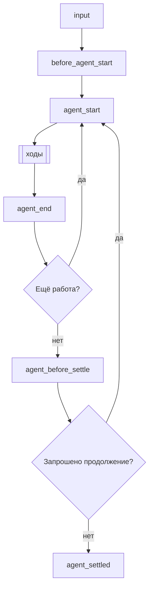
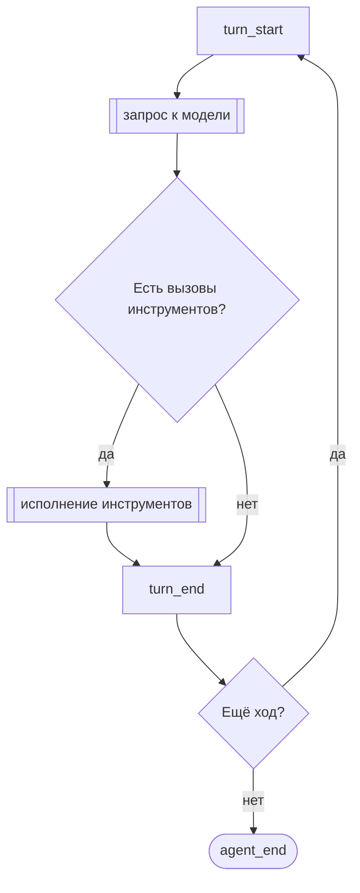
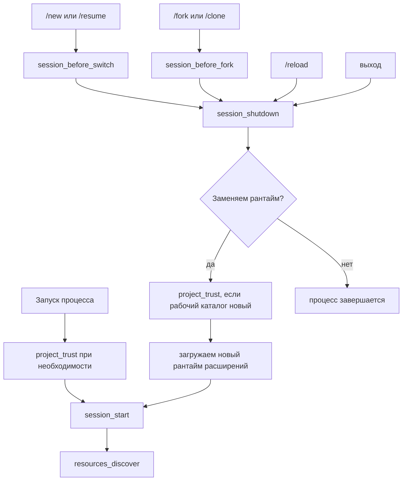

# Расширения (перевод страницы https://pi.dev/docs/latest/extensions)

> Pi умеет создавать расширения. Попросите его собрать расширение под вашу задачу.

Расширения — это модули на TypeScript, которые расширяют поведение Pi. Они могут подписываться на события жизненного цикла, регистрировать собственные инструменты, вызываемые LLM, добавлять команды и так далее.

Расширение выполняется внутри процесса Pi с теми же правами доступа к операционной системе. Оно может видеть промпты, вызовы инструментов, файлы, учётные данные и историю сессии, поэтому загружайте расширения только из источников, которым доверяете.

> **Размещение ради `/reload`:** кладите расширения в `~/.pi/agent/extensions/` (глобально) или `.pi/extensions/` (локально в проекте) — тогда они находятся автоматически. `pi -e ./path.ts` используйте только для быстрых проверок. Расширения из автоматически обнаруживаемых каталогов можно перезагружать на ходу командой `/reload`.

**Основные возможности:**

- **Свои инструменты** — регистрируйте инструменты, которые вызывает LLM, через `pi.registerTool()`
- **Перехват событий** — блокируйте или изменяйте вызовы инструментов, подмешивайте контекст, настраивайте компакцию
- **Взаимодействие с пользователем** — спрашивайте пользователя через `ctx.ui` (select, confirm, input, notify)
- **Свои TUI-компоненты** — полноценные компоненты терминального интерфейса с клавиатурным вводом через `ctx.ui.custom()` для сложных сценариев
- **Свои команды** — регистрируйте команды вида `/mycommand` через `pi.registerCommand()`
- **Хранение состояния между перезапусками** — сохраняйте состояние, переживающее перезапуск, через `pi.appendEntry()`
- **Своё отображение** — управляйте тем, как вызовы инструментов, результаты и сообщения выглядят в TUI
- **Провайдеры и MCP-серверы** — регистрируйте модели-провайдеры, виртуальные модели и MCP-серверы

**Примеры задач:**

- Фильтры разрешений (спрашивать подтверждение перед `rm -rf`, `sudo` и т.п.)
- Точки восстановления в git (stash на каждом ходе, восстановление при смене ветки)
- Защита путей (запрет записи в `.env`, `node_modules/`)
- Своя компакция (суммировать разговор по-своему)
- Итоги разговора (см. пример `summarize.ts`)
- Интерактивные инструменты (вопросы, мастера, собственные диалоги)
- Инструменты с состоянием (списки задач, пулы соединений)
- Внешние интеграции (наблюдатели за файлами, вебхуки, запуск CI)
- Игры в ожидании (см. пример `snake.ts`)

Рабочие реализации — в [examples/extensions/](https://github.com/earendil-works/pi/blob/main/packages/coding-agent/examples/extensions).

## Содержание

- [Расположение расширений](#расположение-расширений)
- [Доступные импорты](#доступные-импорты)
- [Написание расширения](#написание-расширения)
  - [Стили расширения](#стили-расширения)
- [События](#события)
  - [Обзор жизненного цикла](#обзор-жизненного-цикла)
  - [Композиция обработчиков](#композиция-обработчиков)
  - [События запуска](#события-запуска)
  - [События ресурсов](#события-ресурсов)
  - [События сессии](#события-сессии)
  - [События пользовательского bash](#события-пользовательского-bash)
- [ExtensionContext](#extensioncontext)
- [ExtensionCommandContext](#extensioncommandcontext)
- [Методы ExtensionAPI](#методы-extensionapi)
- [Управление состоянием](#управление-состоянием)
- [Свои инструменты](#свои-инструменты)
  - [Видимость инструментов](#видимость-инструментов)
  - [Вызов других инструментов](#вызов-других-инструментов)
  - [Динамическая загрузка инструментов](#динамическая-загрузка-инструментов)
- [Обработка ошибок](#обработка-ошибок)
- [Поведение по режимам](#поведение-по-режимам)
- [Справочник примеров](#справочник-примеров)

## Быстрый старт

Создайте `~/.pi/agent/extensions/my-extension.ts`:

```typescript
import type { ExtensionAPI } from "@earendil-works/pi-coding-agent";
import { Type } from "typebox";

export default function (pi: ExtensionAPI) {
  // Реагируем на события
  pi.on("session_start", async (_event, ctx) => {
    ctx.ui.notify("Extension loaded!", "info");
  });

  pi.on("tool_call", async (event, ctx) => {
    if (isToolCallEventType("bash", event) && event.input.command.includes("rm -rf")) {
      const ok = await ctx.ui.confirm("Dangerous!", "Allow rm -rf?");
      if (!ok) return { block: true, reason: "Blocked by user" };
    }
  });

  // Регистрируем свой инструмент
  pi.registerTool({
    name: "greet",
    label: "Greet",
    description: "Greet someone by name",
    parameters: Type.Object({
      name: Type.String({ description: "Name to greet" }),
    }),

    async execute(toolCallId, params, signal, onUpdate, ctx) {
      return {
        content: [{ type: "text", text: `Hello, ${params.name}!` }],
        details: {},
      };
    },
  });

  // Регистрируем команду
  pi.registerCommand("hello", {
    description: "Say hello",
    handler: async (args, ctx) => {
      ctx.ui.notify(`Hello ${args || "world"}!`, "info");
    },
  });
}
```

Проверьте с флагом `--extension` (или `-e`):

```bash
pi -e ./my-extension.ts
```

## Расположение расширений

> **Безопасность:** расширения работают с полными правами вашей системы и могут выполнять произвольный код. Устанавливайте их только из источников, которым доверяете.

Расширения находятся автоматически из надёжных расположений. Записи проекта в `.pi/extensions` загружаются только после того, как проекту выдано доверие.

| Расположение | Область действия |
| --- | --- |
| `~/.pi/agent/extensions/*.ts` или `*.js` | Глобально (все проекты) |
| `~/.pi/agent/extensions/*/index.ts` или `index.js` | Глобально (в подкаталоге) |
| `~/.pi/agent/extensions/*/package.json` с полем `pi.extensions` | Глобально (подкаталог с манифестом) |
| `.pi/extensions/...` | Локально в проекте, те же варианты раскладки |

Обнаружение идёт на один уровень вглубь. Более крупные пакеты объявляют свои точки входа в манифесте `package.json`.

Дополнительные пути задаются в `settings.json`:

```json
{
  "packages": [
    "npm:@foo/bar@1.0.0",
    "git:github.com/user/repo@v1"
  ],
  "extensions": [
    "/path/to/local/extension.ts",
    "/path/to/local/extension/dir"
  ]
}
```

В настройках можно указывать и встроенные расширения записями вида `builtin:<name>`; см. [Настройки](https://pi.dev/docs/latest/settings#resources). Чтобы распространять расширения через npm или git как пакеты Pi, см. [packages.md](https://pi.dev/docs/latest/packages).

## Доступные импорты

| Пакет | Назначение |
| --- | --- |
| `@earendil-works/pi-coding-agent` | Типы расширений (`ExtensionAPI`, `ExtensionContext`, события) и вспомогательные функции |
| `@earendil-works/pi-agent-core` | Типы сообщений агента и инструментов |
| `typebox`, `typebox/compile`, `typebox/value` | Схемы для параметров инструментов |
| `@earendil-works/pi-ai` | Утилиты работы с LLM (`StringEnum` для строковых перечислений, помощники по транскрипту, типы моделей). Внутри Pi пакет также экспортирует `Type`, `Static` и `TSchema` из TypeBox, которые опубликованный пакет больше не реэкспортирует; в новом коде импортируйте их из `typebox` |
| `@earendil-works/pi-ai/compat`, `/models`, `/oauth`, `/providers/all` | Построение провайдеров, встроенные API и помощники OAuth |
| `@earendil-works/pi-tui` | TUI-компоненты для собственного отображения |

Pi подставляет вместо этих импортов собственные копии, поэтому расширения используют те же классы и реестры, что и Pi. Старые имена `@mariozechner/*` и `@sinclair/typebox` указывают на те же модули.

Зависимости из npm тоже работают. Положите `package.json` рядом с расширением (или в каталог уровнем выше), выполните `npm install` — импорты из `node_modules/` разрешатся автоматически.

Для распространяемых пакетов Pi, установленных через `pi install` (npm или git), runtime-зависимости должны находиться в `dependencies`; `devDependencies` не устанавливаются. Не перечисляйте в `dependencies` пакеты от хоста, указанные выше. См. [Объявление зависимостей](https://pi.dev/docs/latest/packages#declare-dependencies).

###  Схемы параметров инструментов и TypeBox

Pi проверяет аргументы инструмента как JSON Schema с помощью `@earendil-works/pi-schema` — независимо от того, чем схема построена; схемы TypeBox являются JSON Schema и работают без изменений. Перед проверкой слабо типизированные аргументы приводятся к нужному виду: строки с числами становятся числами, `"true"` становится `true`, одиночное значение превращается в массив из одного элемента, `null` в необязательном свойстве отбрасывается. Возможности TypeBox, выходящие за рамки JSON Schema, к аргументам инструментов не применяются:

- Уточнения `Type.Refine()` не выполняются. Проверяйте такие ограничения в `execute()`.
- `Type.BigInt()`, `Type.Undefined()` и `Type.Void()` отклоняют любой аргумент, потому что в JSON таких значений нет. Кодеки (`Type.Codec()`) не декодируют: `execute()` получает JSON-значение.
- Форматы, зарегистрированные через `Format.Set()` у TypeBox, не проверяются. Стандартные форматы при этом проверяются, плюс `url` и `json-pointer-uri-fragment`.
- Имена свойств сопоставляются как имена, а не как регулярные выражения, а `additionalProperties` действует только для свойств, которые объект не объявляет.
- `$ref`, который ни на что не указывает, отклоняет аргументы только на своём месте.

Ошибки валидации модель видит в формулировках pi-schema, например `- path: missing` или `- limit: expected number, got string`.

Встроенные модули Node.js (`node:fs`, `node:path` и т.д.) тоже доступны.

## Написание расширения

Расширение экспортирует фабрику по умолчанию, которая получает `ExtensionAPI`. Фабрика может быть синхронной или асинхронной:

```typescript
import type { ExtensionAPI } from "@earendil-works/pi-coding-agent";

export default function (pi: ExtensionAPI) {
  // Подписываемся на события
  pi.on("event_name", async (event, ctx) => {
    // ctx.ui — взаимодействие с пользователем
    const ok = await ctx.ui.confirm("Title", "Are you sure?");
    ctx.ui.notify("Done!", "info");
    ctx.ui.setStatus("my-ext", "Processing...");  // статус в футере
    ctx.ui.setWidget("my-ext", ["Line 1", "Line 2"]);  // виджет над редактором (по умолчанию)
  });

  // Регистрируем инструменты, команды, сочетания клавиш, флаги
  pi.registerTool({ ... });
  pi.registerCommand("name", { ... });
  pi.registerShortcut("ctrl+x", { ... });
  pi.registerFlag("my-flag", { ... });
}
```

Расширения загружаются через [jiti](https://github.com/unjs/jiti), поэтому TypeScript работает без компиляции.

Если фабрика возвращает `Promise`, Pi дожидается её перед продолжением запуска. Это значит, что асинхронная инициализация завершится до `session_start`, до `resources_discover` и до того, как будут применены регистрации провайдеров, поставленные в очередь через `pi.registerProvider()`.

###  Асинхронные фабрики

Используйте асинхронную фабрику для разовой работы при запуске: получить конфигурацию из сети, динамически узнать список доступных моделей.

```typescript
import type { ExtensionAPI } from "@earendil-works/pi-coding-agent";

export default async function (pi: ExtensionAPI) {
  const response = await fetch("http://localhost:1234/v1/models");
  const payload = (await response.json()) as {
    data: Array<{
      id: string;
      name?: string;
      context_window?: number;
      max_tokens?: number;
    }>;
  };

  pi.registerProvider("local-openai", {
    baseUrl: "http://localhost:1234/v1",
    apiKey: "$LOCAL_OPENAI_API_KEY",
    api: "openai-completions",
    models: payload.data.map((model) => ({
      id: model.id,
      name: model.name ?? model.id,
      reasoning: false,
      input: ["text"],
      cost: { input: 0, output: 0, cacheRead: 0, cacheWrite: 0 },
      contextWindow: model.context_window ?? 128000,
      maxTokens: model.max_tokens ?? 4096,
    })),
  });
}
```

Этот приём делает полученные модели доступными и при обычном запуске, и в выводе `pi --list-models`. Если список моделей меняется во время работы Pi, реализуйте вместо этого `refreshModels`; см. [pi.registerProvider(name, config)](https://pi.dev/docs/latest/extensions#piregisterprovidername-config).

###  Долгоживущие ресурсы и завершение работы

Фабрики расширений могут вызываться в запусках, которые вообще не начинают сессию. Не запускайте из фабрики фоновые ресурсы: процессы, сокеты, наблюдатели за файлами, таймеры.

Откладывайте запуск фоновых ресурсов до `session_start` или до команды/инструмента/события, которым ресурс нужен. Зарегистрируйте идемпотентный обработчик `session_shutdown`, чтобы закрывать ресурсы, созданные в рамках сессии.

### Стили расширения

**Один файл** — простейший вариант для небольших расширений:

```
~/.pi/agent/extensions/
└── my-extension.ts
```

**Каталог с index.ts** — для расширений из нескольких файлов:

```
~/.pi/agent/extensions/
└── my-extension/
    ├── index.ts        # точка входа (экспортирует функцию по умолчанию)
    ├── tools.ts        # вспомогательный модуль
    └── utils.ts        # вспомогательный модуль
```

**Пакет с зависимостями** — когда расширению нужны npm-пакеты:

```
~/.pi/agent/extensions/
└── my-extension/
    ├── package.json    # объявляет зависимости и точки входа
    ├── package-lock.json
    ├── node_modules/   # после npm install
    └── src/
        └── index.ts
```

```json
// package.json
{
  "name": "my-extension",
  "dependencies": {
    "zod": "^3.0.0",
    "chalk": "^5.0.0"
  },
  "pi": {
    "extensions": ["./src/index.ts"]
  }
}
```

Выполните `npm install` в каталоге расширения — после этого импорты из `node_modules/` работают автоматически.

## События

### Обзор жизненного цикла

Промпт запускает выполнение. Сначала обрабатывается ввод:

1. Команды расширений (`/name`) выполняют свой обработчик. Событие `input` при этом не срабатывает. Введённые вручную и RPC-промпты всегда проверяются на команды; `pi.sendUserMessage()` проверяет только при `expandPromptTemplates: true`.
2. Обработчики `input` могут перехватить, преобразовать или взять текст на себя.
3. Разворачиваются команды навыков (`/skill:name`) и шаблоны промптов (`/template`).
4. Выполняется `before_agent_start`, после чего начинается цикл агента.

Далее выполнение повторяет ходы и проверяет, не началась ли ещё одна низкоуровневая сессия агента:



«Ещё работа» означает повторную попытку, восстановление на последней попытке, повтор после компакции или сообщения из очереди. Поэтому `agent_end` — не признак окончательного простоя; для этого служит `agent_settled`. Прерванное выполнение пропускает `agent_before_settle` и переходит от `agent_end` сразу к `agent_settled`. Pi считает себя занятым, пока выполнение запускается, включая проверку компакции и `before_agent_start`, — сообщения, отправленные в этот момент, попадают в запускаемое выполнение.

Каждый ход делает один запрос к модели и исполняет вызовы инструментов из ответа ассистента:



Запрос к модели выполняет хуки в таком порядке:

1. `context` (может изменять сообщения разговора)
2. `context_with_system` (может изменять весь транскрипт)
3. `before_provider_headers` (может менять заголовки)
4. `before_provider_request` (может inspect-ить или заменять полезную нагрузку)
5. `after_provider_response` (статус и заголовки, до потребления потока)
6. `provider_stream_event` (сырые разобранные события потока), а также `message_start` / `message_update` / `message_end` для сообщения ассистента

Вызов инструмента, который исполняется, проходит хуки в таком порядке:

1. `tool_execution_start`
2. `tool_call` (может заблокировать или изменить входные данные)
3. `tool_execution_update` во время исполнения инструмента
4. `tool_result` (может изменить результат)
5. `tool_execution_end`

Вызовы, которые не исполняются, обрываются раньше. Неизвестный инструмент или некорректные аргументы пропускают `tool_call`; заблокированный или прерванный вызов пропускает исполнение и `tool_result`. Но каждый из них всё равно получает `tool_execution_end` с ошибочным результатом, поэтому наблюдайте за всеми завершёнными вызовами через `tool_execution_end`.

`turn_end` может добавлять записи и запрашивать продолжение. Компакция по порогу выполняется до того, как естественным образом потребуется следующий ход. События сообщений срабатывают и для других сообщений: пользовательских, результатов инструментов, собственных сообщений. Хуки провайдера срабатывают только там, где транспорт раскрывает соответствующую стадию.

Запуск сессии и её замена живут в отдельном жизненном цикле:



`session_start` передаёт `reason: "startup" | "reload" | "new" | "resume" | "fork"`, а `session_shutdown` — `reason: "quit" | "reload" | "new" | "resume" | "fork"`. `resources_discover` использует `reason: "reload"` после перезагрузки и `"startup"` во всех остальных случаях. Под «выходом» понимаются Ctrl+C, Ctrl+D, SIGHUP и SIGTERM. `project_trust` выполняется до загрузки ресурсов проекта, требующих доверия, и может сработать снова, когда замена сессии переводит в новый рабочий каталог.

Другие операции меняют текущую сессию без замены рантайма:

| Операция | События |
| --- | --- |
| `/compact` или автоматическая компакция | `session_before_compact` (можно отменить или настроить), затем `session_compact` или `session_compact_failed` |
| Навигация `/tree` | `session_before_tree` (можно отменить или настроить), затем `session_tree` |
| `/name` или `pi.setSessionName()` | `session_info_changed` |
| `/model` или перебор моделей (`Ctrl+P`) | `thinking_level_select`, если уровень меняется или ограничивается, затем `model_select` |
| Смена уровня размышлений (настройки, сочетание клавиш, `pi.setThinkingLevel()`) | `thinking_level_select` |
| Команда `!` или `!!` | `user_bash` (можно перехватить) |
| Диалог расширения или собственный экран ждёт пользователя | `ui_prompt_start`, `ui_prompt_end` |
| Обновление промпт-кэша в простое | `cache_warming_decision` |
| Расширение регистрирует или убирает MCP-сервер после запуска | `mcp_servers_change` |

### Композиция обработчиков

Обработчики выполняются в порядке загрузки расширений, внутри расширения — в порядке регистрации. Часть событий только уведомляет; другие преобразуют данные, заменяют результат или отменяют операцию:

| Паттерн | Поведение |
| --- | --- |
| Уведомление | Возвращаемые значения игнорируются. Используйте событие только для наблюдения. |
| Изменение на месте | Последующие обработчики видят изменения таких значений, как `before_provider_headers.headers`, `before_agent_start.systemPromptOptions`, `tool_call.input`. |
| Цепочка преобразований | Последующие обработчики получают значение, возвращённое предыдущими обработчиками `input`, `context`, `context_with_system`, `message_end`, `tool_result` и `before_provider_request`. |
| Фильтр (gate) | Обработанный ввод, заблокированный вызов инструмента, отменённая операция с сессией или взятая на себя команда `user_bash` останавливают обычный путь этой операции. |
| Граница с правом действия | Каждый обработчик `turn_end` или `agent_before_settle` видит записи и решение о продолжении, предложенные к текущему моменту. |
| Последнее переопределение | Побеждает последний обработчик `cache_warming_decision`, вернувший действие. |

Уведомляющим обработчикам не стоит выполнять долгую работу на потоковом событии. Преобразующим — сохранять поля, которыми они намеренно не владеют. Фильтрам — отказывать (fail closed), когда решение о безопасности принять нельзя.

### События запуска

####  project_trust

Срабатывает до того, как Pi решает, доверять ли проекту с динамическими конфигурациями (`.pi` или `.agents/skills`). Выполняется при запуске и когда замена сессии (например `/resume`) переводит в cwd, доверие к которому в текущем процессе ещё не определено. Участвуют только пользовательские/глобальные расширения и расширения, переданные через `-e`; локальные расширения проекта загружаются лишь после вынесения вердикта о доверии.

```typescript
pi.on("project_trust", async (event, ctx) => {
  // event.cwd - текущий рабочий каталог
  // ctx — ограниченный контекст доверия: cwd, mode, hasUI и помощники select/confirm/input/notify
  if (await ctx.ui.confirm("Trust project?", event.cwd)) {
    return { trusted: "yes", remember: true };
  }
  return { trusted: "undecided" };
});
```

Обработчик `project_trust` обязан вернуть `{ trusted: "yes" | "no" | "undecided" }`. Пользовательское, глобальное или CLI-расширение, вернувшее `"yes"` или `"no"`, владеет решением; первое да/нет побеждает и подавляет встроенный запрос о доверии. Используйте `remember: true`, чтобы сохранить решение да/нет надолго, иначе оно действует только в текущем процессе. Верните `"undecided"`, чтобы решение перешло к последующим обработчикам или к встроенной процедуре. Проверяйте `ctx.hasUI` перед показом вопроса. Если ни один обработчик не ответил да/нет, обычное разрешение доверия продолжается: сначала применяются сохранённые решения из `trust.json`, затем `defaultProjectTrust` определяет, спрашивает ли Pi, доверяет или отказывает по умолчанию.

### События ресурсов

####  resources_discover

Срабатывает после `session_start`, чтобы расширения могли добавить свои пути к навыкам, промптам и темам. При запуске приходит `reason: "startup"`, при перезагрузке — `reason: "reload"`.

```typescript
pi.on("resources_discover", async (event, _ctx) => {
  // event.cwd - текущий рабочий каталог
  // event.reason - "startup" | "reload"
  return {
    skillPaths: ["/path/to/skills"],
    promptPaths: ["/path/to/prompts"],
    themePaths: ["/path/to/themes"],
  };
});
```

####  mcp_servers_change

Срабатывает, когда расширение регистрирует или снимает MCP-сервер после привязки расширений. `event.servers` перечисляет каждый зарегистрированный сервер после изменения. Обработка этого события помечает расширение как то, что подключает зарегистрированные серверы; см. [MCP-серверы](#mcp-серверы).

### События сессии

Хранение сессий и API SessionManager описаны в [Session Format](https://pi.dev/docs/latest/session-format).

####  session_start

Срабатывает, когда сессия запущена, загружена или перезагружена.

```typescript
pi.on("session_start", async (event, ctx) => {
  // event.reason - "startup" | "reload" | "new" | "resume" | "fork"
  // event.previousSessionFile - присутствует для "new", "resume" и "fork"
  ctx.ui.notify(`Session: ${ctx.sessionManager.getSessionFile() ?? "ephemeral"}`, "info");
});
```

####  session_info_changed

Срабатывает, когда отображаемое имя сессии задано через `/name`, RPC или `pi.setSessionName()`.

```typescript
pi.on("session_info_changed", async (event, ctx) => {
  // event.name - текущее нормализованное имя либо undefined, если имя снято
  ctx.ui.notify(`Session renamed: ${event.name ?? "(none)"}`, "info");
});
```

####  session_before_switch

Срабатывает перед созданием новой сессии (`/new`) или переключением (`/resume`).

```typescript
pi.on("session_before_switch", async (event, ctx) => {
  // event.reason - "new" или "resume"
  // event.targetSessionFile - сессия, в которую переключаемся (только для "resume")

  if (event.reason === "new") {
    const ok = await ctx.ui.confirm("Clear?", "Delete all messages?");
    if (!ok) return { cancel: true };
  }
});
```

После успешного переключения или создания сессии Pi рассылает старому экземпляру расширений `session_shutdown`, перезагружает и привязывает расширения к новой сессии, затем рассылает `session_start` с `reason: "new" | "resume"` и `previousSessionFile`. Уборку делайте в `session_shutdown`, а состояние в памяти восстанавливайте в `session_start`.

####  session_before_fork

Срабатывает при ветвлении через `/fork` или клонировании через `/clone`.

```typescript
pi.on("session_before_fork", async (event, ctx) => {
  // event.entryId - ID выбранной записи
  // event.position - "before" для /fork, "at" для /clone
  return { cancel: true }; // Отменить fork/clone
  // ИЛИ
  return { skipConversationRestore: true }; // Зарезервировано на будущее: управление восстановлением разговора
});
```

После успешного ветвления или клонирования Pi рассылает старому экземпляру расширений `session_shutdown`, перезагружает и привязывает расширения к новой сессии, затем рассылает `session_start` с `reason: "fork"` и `previousSessionFile`. Уборку делайте в `session_shutdown`, а состояние в памяти восстанавливайте в `session_start`.

####  session_before_compact / session_compact / session_compact_failed

Срабатывают при компакции. Подробности — в [compaction.md](https://pi.dev/docs/latest/compaction).

```typescript
pi.on("session_before_compact", async (event, ctx) => {
  const { preparation, branchEntries, customInstructions, reason, willRetry, signal } = event;

  // reason - "manual" (/compact), "threshold" или "overflow"
  // willRetry - будет ли прерванный ход повторён после компакции (восстановление после переполнения)

  // Отменить:
  return { cancel: true };

  // Собственное резюме:
  return {
    compaction: {
      summary: "...",
      firstKeptEntryId: preparation.firstKeptEntryId,
      tokensBefore: preparation.tokensBefore,
      // usage: summaryResponse.usage, // необязательно; учитывается в итогах сессии
    },
  };
});

pi.on("session_compact", async (event, ctx) => {
  // event.compactionEntry - сохранённая запись компакции
  // event.fromExtension - предоставило ли её расширение
  // event.reason - "manual" (/compact), "threshold" или "overflow"
  // event.willRetry - будет ли прерванный ход повторён после компакции (восстановление после переполнения)
});

pi.on("session_compact_failed", async (event, ctx) => {
  // event.reason - "manual" (/compact), "threshold" или "overflow"
  // event.errorMessage - присутствует при сбоях, не связанных с прерыванием
  // event.aborted - true при отменённых/прерванных компакциях
  // event.willRetry - было бы повторение после компакции
  // event.fromExtension - использовалось ли содержимое компакции от расширения
});
```

####  session_before_tree / session_tree

Срабатывают при навигации `/tree`. Понятия дерева сессий — в [Sessions](https://pi.dev/docs/latest/sessions).

```typescript
pi.on("session_before_tree", async (event, ctx) => {
  const { preparation, signal } = event;
  // preparation.targetId, oldLeafId, commonAncestorId, entriesToSummarize,
  // userWantsSummary, customInstructions, replaceInstructions, label
  return { cancel: true };
  // ИЛИ отдать своё резюме (используется только если preparation.userWantsSummary === true):
  return {
    summary: {
      summary: "...",
      // usage: summaryResponse.usage, // необязательно; учитывается в итогах сессии
      details: {},
    },
  };
  // ИЛИ переопределить параметры суммирования: customInstructions, replaceInstructions, label
});

pi.on("session_tree", async (event, ctx) => {
  // event.newLeafId, oldLeafId, summaryEntry, fromExtension
});
```

####  session_shutdown

Срабатывает перед разборкой запущенного рантайма сессии. Используйте его, чтобы освободить ресурсы, открытые из `session_start` и других обработчиков уровня сессии.

```typescript
pi.on("session_shutdown", async (event, ctx) => {
  // event.reason - "quit" | "reload" | "new" | "resume" | "fork"
  // event.targetSessionFile - целевая сессия для сценариев замены
  // Уборка, сохранение состояния и т.п.
});
```

### События агента

####  before_agent_start

Срабатывает перед началом выполнения — после обработки ввода и разворачивания шаблонов. Может добавить сообщение и/или изменить системный промпт.

`event.messageType` говорит, что запустило выполнение: `"user"` для промпта или `pi.sendUserMessage()` (с `prompt` и `images`); `"custom"` для `pi.sendMessage(..., { triggerTurn: true })` в простое (с исходным `message` и без `prompt`).

```typescript
pi.on("before_agent_start", async (event, ctx) => {
  // event.messageType - "user" | "custom"
  // event.prompt, event.images - текст промпта и картинки пользователя (messageType "user")
  // event.message - собственное сообщение, запустившее выполнение (messageType "custom")
  // event.systemPrompt - текущий (для этого обработчика) системный промпт из цепочки
  //   (включает изменения предыдущих обработчиков before_agent_start)
  // event.systemPromptOptions - структурированные параметры, из которых собран системный промпт
  //   .customPrompt - точная префикс-часть промпта из --system-prompt, SYSTEM.md или пользовательских шаблонов
  //   .forceSystemPrompt - необязательная полная замена всего промпта
  //   .selectedTools - инструменты, активные в промпте сейчас
  //   .hiddenTools - активные инструменты, чьи декларации запросы опускают
  //   .toolSnippets - по одному короткому описанию на инструмент
  //   .toolGuidelines - списки правил по каждому инструменту
  //   .promptGuidelines - дополнительные пользовательские правила
  //   .sections - собственные секции в XML-обёртке, ключ — имя тега
  //   .appendSystemPrompt - текст из флагов --append-system-prompt
  //   .cwd - рабочий каталог
  //   .contextFiles - файлы AGENTS.md и прочие загруженные контекстные файлы
  //   .skills - загруженные навыки

  return {
    // Добавить постоянное сообщение (хранится в сессии, уходит в LLM)
    message: {
      customType: "my-extension",
      content: "Additional context for the LLM",
      display: true,
    },

    // Заменить системный промпт на этом ходе (цепочка через расширения)
    systemPrompt: event.systemPrompt + "\n\nExtra instructions for this turn...",
  };
});
```

Возвращённое `message` добавляется к любому из двух типов выполнения; проверяйте `messageType`, чтобы пропускать запуски, начатые собственными сообщениями.

Поле `systemPromptOptions` даёт расширениям те же структурированные данные, что использует Pi для сборки системного промпта. Коллекции изменяемы. Менять лучше `sections`, `selectedTools` или `promptGuidelines`: Pi сравнивает получившиеся секции промпта с тем, что уже есть у модели, и дописывает одно системное сообщение, правящее только изменившиеся секции. Возврат `systemPrompt` либо установка `forceSystemPrompt` заменяют весь промпт на время выполнения: каждый провайдер получает принудительный текст как ведущий системный промпт (промах кэша при его изменении), а транскрипт сессии продолжает хранить структурированные секции. Изменения набора инструментов обновляют и вклад в промпт, и исполняемые инструменты провайдера; вызов `pi.setActiveTools()` внутри обработчика действует так же, как правка `selectedTools`. Модели, принимающие системные сообщения в середине разговора, получают заплатку на место и сохраняют закэшированный префикс; остальные получают воспроизведённый промпт как свой системный промпт — это один промах кэша на каждое изменение.

Внутри `before_agent_start` и `event.systemPrompt`, и `ctx.getSystemPrompt()` отражают системный промпт из цепочки на момент текущего обработчика. Последующие обработчики `before_agent_start` всё ещё могут изменить его снова.

####  agent_start / agent_end / agent_before_settle / agent_settled

`agent_start` срабатывает, когда начинается низкоуровневое выполнение агента. `agent_end` — когда оно заканчивается, но Pi ещё может автоматически повторить попытку, скомпактовать и повторить или продолжить сообщениями из очереди. `agent_before_settle` — последняя граница, где ещё можно действовать: она добавляет записи в сессию и запрашивает одно продолжение. `agent_settled` окончательна и только уведомляет; используйте её для интеграций статуса, которым важно, что Pi не собирается продолжать сам.

```typescript
pi.on("agent_start", async (_event, ctx) => {});

pi.on("agent_end", async (event, ctx) => {
  // event.messages - сообщения этого низкоуровневого выполнения
});

let addedReviewReminder = false;
pi.on("agent_before_settle", async (event, ctx) => {
  if (addedReviewReminder) return;
  addedReviewReminder = true;
  return {
    entries: [...event.entries, {
      type: "custom_message",
      customType: "review-reminder",
      content: "Review the final diff before replying.",
      display: false,
    }],
    continue: true,
  };
});

pi.on("agent_settled", async (event, ctx) => {
  // event.aborted - true, если выполнение прервали (например клавишей Escape)
  // ctx.isIdle() здесь true; выполнения, запрошенные тут, стартуют после завершения всех обработчиков settled
});
```

Если выполнение прерывают, пока работают обработчики `agent_before_settle`, корректные возвращённые записи всё равно сохраняются, но запрошенное продолжение подавляется. Работа, запрошенная из `agent_settled`, откладывается до завершения каждого обработчика settled — рассылка уведомлений не реентерабельна.

####  ui_prompt_start / ui_prompt_end

Уведомительные события жизненного цикла вокруг блокирующих пользовательских диалогов расширений. Они окружают `ctx.ui.select()`, `ctx.ui.confirm()`, `ctx.ui.input()`, `ctx.ui.editor()` и `ctx.ui.custom()`, чтобы хост и статусные интеграции могли показывать «ждём пользователя», а не просто «работаем».

Вложенные или перекрывающиеся диалоги сворачиваются в одно внешний интервал ожидания. Обработчики вызываются по возможности best-effort: перед показом и закрытием диалога их не ждут.

```typescript
pi.on("ui_prompt_start", async (event, ctx) => {
  // event.reason === "ui_prompt"
  // event.kind: "select" | "confirm" | "input" | "editor" | "custom"
  // event.title: заголовок диалога, если есть
});

pi.on("ui_prompt_end", async (event, ctx) => {
  // Pi больше не ждёт ответа в этом интервале UI-диалога.
});
```

####  turn_start / turn_end

Срабатывают на каждый ход (один ответ LLM + вызовы инструментов).

```typescript
pi.on("turn_start", async (event, ctx) => {
  // event.turnIndex, event.timestamp
});

let replacedResponse = false;
pi.on("turn_end", async (event, ctx) => {
  // event.turnIndex, event.message, event.toolResults
  // event.entries содержит структурные записи, предложенные к этому моменту.
  if (replacedResponse || event.outcome !== "completed" || event.toolResults.length === 0) return;
  replacedResponse = true;
  return {
    entries: [
      ...event.entries,
      { type: "context_edit", targetId: event.messageEntryId, replacement: null },
      {
        type: "custom_message",
        customType: "replacement-instruction",
        content: "Answer again using the persisted user request.",
        display: false,
      },
    ],
    continue: true,
  };
});
```

`turn_end` выполняется после того, как сообщения ассистента и результатов инструментов сохранены, но до низкоуровневого события `turn_end`. Паузы повторных попыток и восстановление на последней попытке по-прежнему происходят после `agent_end`, сохраняя привычный жизненный цикл и порядок очередей; `agent_before_settle` видит исправленный проект уже после этой работы. Граничные обработчики идут в порядке загрузки и регистрации расширений. Каждый видит предыдущие предложения в `event.entries` и `event.context`, пересобранный из них. Возврат `entries` или `continue` заменяет только это поле; пропущенные поля сохраняют текущее предложение. Допустимые типы черновых записей: `custom`, `custom_message`, `context_edit`, `compaction`. Полное предложение проверяется целиком и лишь потом добавляется списком после завершения всех обработчиков; ошибка обработчика сообщается, но остальные продолжают работать. Проверка защищает от частичного применения смысловых ошибок, но сохранение не транзакционно.

`continue: true` гарантирует один следующий запрос к провайдеру для этого обращения к границе. Если запрос уже неизбежен из-за результатов инструментов, корректировки или последующего сообщения, решение считается выполненным и лишний запрос не делается; иначе Pi делает один запрос только с контекстом. Ошибочные и прерванные ответы остаются жёстким выходом. `continue: false` никогда не подавляет естественную работу. Берегите условия продолжения: безусловный `continue: true` проверяется снова после следующего ответа и способен создать бесконечный цикл. Черновая `custom_message` даёт сообщение роли «пользователь», но написано расширением: для него не запускаются обработчики пользовательского ввода, slash-команды, навыки и шаблоны промптов.

Интеграции, которые конструируют значения `TurnEndEvent`, обязаны передать `messageEntryId`, `toolResultEntryIds`, `outcome`, `entries`, `continue` и `context`. Полные switch по `ExtensionEvent` должны также обрабатывать `agent_before_settle`. `ExtensionRunner.emit()` не рассылает действенные границы хода; рассылайте `turn_end` и `agent_before_settle` через `emitBoundary(baseEvent, buildContext)`, чтобы обработчики получали цепочечные предложения. Другие специальные методы раннера по-прежнему возвращают результаты для событий вроде `session_before_*`.

####  message_start / message_update / message_end

Срабатывают при изменениях жизненного цикла сообщений.

- `message_start` и `message_end` срабатывают для любого сообщения: пользовательского, ассистента, результата инструмента, собственного.
- `message_update` срабатывает на потоковые обновления сообщения ассистента.
- Обработчики `message_end` могут вернуть `{ message }`, чтобы заменить итоговое сообщение. Замена обязана сохранить тот же `role`.

```typescript
pi.on("message_start", async (event, ctx) => {
  // event.message
});

pi.on("message_update", async (event, ctx) => {
  // event.message
  // event.assistantMessageEvent (потоковое событие по токенам)
});

pi.on("message_end", async (event, ctx) => {
  if (event.message.role !== "assistant") return;

  return {
    message: {
      ...event.message,
      usage: {
        ...event.message.usage,
        cost: {
          ...event.message.usage.cost,
          total: 0.123,
        },
      },
    },
  };
});
```

####  tool_execution_start / tool_execution_update / tool_execution_end

Срабатывают при изменениях жизненного цикла исполнения инструментов.

В параллельном режиме исполнения:

- `tool_execution_start` рассылается в исходном порядке ассистента на префлайт-стадии
- `tool_execution_update` могут перемешиваться между инструментами
- `tool_execution_end` рассылается в порядке завершения инструментов, когда каждый финализирован
- итоговые события сообщений `toolResult` всё равно выходят позже — в исходном порядке ассистента

```typescript
pi.on("tool_execution_start", async (event, ctx) => {
  // event.toolCallId, event.toolName, event.args
});

pi.on("tool_execution_update", async (event, ctx) => {
  // event.toolCallId, event.toolName, event.args, event.partialResult
});

pi.on("tool_execution_end", async (event, ctx) => {
  // event.toolCallId, event.toolName, event.result, event.isError
  // event.durationMs - сколько миллисекунд шёл execute(); отсутствует, если инструмент не исполнялся
});
```

Все три события, а также `tool_call` и `tool_result` несут `parentToolCallId`, когда вызов сделан другим инструментом; см. [Вызов других инструментов](#вызов-других-инструментов).

####  context

Срабатывает перед каждым запросом к LLM. Изменяет сообщения неразрушающе. Типы сообщений — в [Session Format](https://pi.dev/docs/latest/session-format).

```typescript
pi.on("context", async (event, ctx) => {
  // event.messages - глубокая копия без системных сообщений, можно менять
  const filtered = event.messages.filter(m => !shouldPrune(m));
  return { messages: filtered };
});
```

`event.messages` содержит разговор без системных сообщений. Промпт и декларации инструментов принадлежат Pi и в этот хук не входят: когда обработчик возвращает изменённый список, Pi воспроизводит текущие секции промпта и декларации инструментов в одном ведущем системном сообщении перед возвращёнными сообщениями. Поэтому фильтрация, выборка окна или срез от резюме компакции не способны потерять промпт или инструменты. Неизменённый список оставляет системные сообщения в середине разговора на своих местах — модели, которые их принимают, сохраняют закэшированный префикс. Системные сообщения, добавленные обработчиком, сохраняются после головы Pi. Чтобы поменять промпт или набор инструментов надолго, используйте [`before_agent_start`](https://pi.dev/docs/latest/extensions#before_agent_start) или `pi.setActiveTools()`; чтобы править системные сообщения на один запрос — [`context_with_system`](https://pi.dev/docs/latest/extensions#context_with_system).

####  context_with_system

Срабатывает перед каждым запросом к LLM, после всех обработчиков `context`, когда Pi восстановил промпт и состояние инструментов. `event.messages` — весь транскрипт, включая ведущее системное сообщение и все заплатки промпта и инструментов в середине разговора промпта и инструментов (см. [Session Format](https://pi.dev/docs/latest/session-format#sessionmessageentry)). Возвращённые сообщения уходят как есть: этот хук владеет промптом и декларациями инструментов на время запроса.

```typescript
import { getCurrentSystemMessage } from "@earendil-works/pi-ai";

pi.on("context_with_system", async (event, ctx) => {
  const cut = findCutIndex(event.messages);
  // Соберите отброшенный префикс так, чтобы его промпт и состояние инструментов выжили в новой голове.
  const head = getCurrentSystemMessage(event.messages.slice(0, cut));
  return { messages: head ? [head, ...event.messages.slice(cut)] : event.messages.slice(cut) };
});
```

Правила: оставляйте системное сообщение на индексе 0 (провайдеры читают там промпт и первоначальные декларации инструментов; Pi сообщит об ошибке, если обработчик их уберёт). Удаление системного сообщения убирает и декларации инструментов, и заплатки секций, которые оно несло. Проверяйте результат через `getCurrentSystemPrompt()` и `getCurrentTools()` из `@earendil-works/pi-ai`. Обработчики идут в порядке загрузки расширений; принудительный `systemPrompt` из `before_agent_start` всё равно проецируется на запрос после этого.

####  before_provider_headers

Срабатывает, когда исходящие HTTP-заголовки уже собраны. Используйте, чтобы добавить, переопределить или убрать заголовок запроса.

Обработчики меняют `event.headers` на месте. Строковое значение добавляет или переопределяет заголовок, `null` — удаляет его.

```typescript
pi.on("before_provider_headers", (event, ctx) => {
  // Добавить или переопределить — например id сессии для трассировки/атрибуции в шлюзе
  event.headers["x-session-id"] = ctx.sessionManager.getSessionId();

  // Убрать заголовок отслеживания, который Pi добавляет для этого вызова
  event.headers["X-OpenRouter-Title"] = null;
});
```

Выполняется один раз на запрос к провайдеру; повторные попытки переиспользуют те же заголовки, хук заново не срабатывает.

####  before_provider_request

Срабатывает после сборки полезной нагрузки конкретного провайдера, прямо перед отправкой запроса. Обработчики идут в порядке загрузки расширений. Возврат `undefined` оставляет нагрузку без изменений. Возврат любого другого значения заменяет нагрузку и для последующих обработчиков, и для реального запроса.

Этот хук способен переписать системные инструкции уровня провайдера или убрать их целиком. Такие изменения на уровне нагрузки не видны через `ctx.getSystemPrompt()` — он сообщает строку системного промпта Pi, а не итоговую сериализованную нагрузку провайдера.

```typescript
pi.on("before_provider_request", (event, ctx) => {
  console.log(JSON.stringify(event.payload, null, 2));

  // Опционально: заменить нагрузку
  // return { ...event.payload, temperature: 0 };
});
```

В основном полезно для отладки сериализации провайдера и поведения кэша.

####  after_provider_response

Срабатывает после получения HTTP-ответа и до потребления тела потока. Обработчики идут в порядке загрузки расширений.

```typescript
pi.on("after_provider_response", (event, ctx) => {
  // event.status - код состояния HTTP
  // event.headers - нормализованные заголовки ответа
  if (event.status === 429) {
    console.log("rate limited", event.headers["retry-after"]);
  }
});
```

Доступность заголовков зависит от провайдера и транспорта. Провайдеры, абстрагирующие HTTP-ответы, могут их не раскрывать.

####  provider_stream_event

Срабатывает на каждое разобранное событие потока провайдера до нормализации Pi. Только уведомление, не сохраняется.

```typescript
pi.on("provider_stream_event", (event, ctx) => {
  // event.provider, event.api, event.model
  // event.data - самое раннее структурированное значение, доступное Pi (только для чтения)
});
```

`event.data` — не обязательно исходные HTTP-байты или SSE-кадр. Относитесь к нему как к данным только для чтения: правка может повлиять на нормализацию. Обработчики ждут в порядке потока, поэтому медленные обработчики задерживают чтение потока. Ошибки обработчиков сообщаются, но не меняют ответ провайдера. См. [`debug-provider.ts`](https://github.com/earendil-works/pi/blob/main/packages/coding-agent/examples/extensions/debug-provider.ts) — включаемый просмотрщик, группирующий сырые события по сообщениям ассистента.

####  cache_warming_decision

Срабатывает перед каждым обновлением промпт-кэша с уже заполненным решением Pi. Событие несёт только оценки стоимости Pi; для остального используйте `ctx.model`, `ctx.isIdle()` и `ctx.getContextUsage()`.

```typescript
pi.on("cache_warming_decision", (event, ctx) => {
  // event.warmCost: цена этого обновления
  // event.missCost: лишняя цена следующего запроса, если запись потеряна
  // event.continuationProbability: оценка Pi, что запрос придёт вовремя
  // event.action: "warm" | "stop", решение Pi

  if (ctx.model?.provider === "my-provider") {
    return { action: "stop" };
  }
});
```

Верните `{ action: "warm" }` или `{ action: "stop" }`, чтобы переопределить; побеждает последний обработчик, вернувший действие. `"stop"` прекращает прогрев до следующего настоящего запроса.

### События моделей

####  model_select

Срабатывает при смене модели через команду `/model`, перебор моделей (`Ctrl+P`) или `pi.setModel()`. Восстановление сессии его не вызывает; чтобы инициализировать зависящее от модели состояние, читайте `ctx.model` в `session_start`.

```typescript
pi.on("model_select", async (event, ctx) => {
  // event.model - новая выбранная модель
  // event.previousModel - прежняя модель (undefined при первом выборе)
  // event.source - "set" | "cycle"

  const prev = event.previousModel
    ? `${event.previousModel.provider}/${event.previousModel.id}`
    : "none";
  const next = `${event.model.provider}/${event.model.id}`;

  ctx.ui.notify(`Model changed (${event.source}): ${prev} -> ${next}`, "info");
});
```

Используйте его для обновления UI (строки статуса, футеры) и модельно-специфичной инициализации при смене активной модели.

####  thinking_level_select

Срабатывает при смене уровня размышлений. Только уведомление; возвращаемые значения обработчиков игнорируются.

```typescript
pi.on("thinking_level_select", async (event, ctx) => {
  // event.level - новый выбранный уровень размышлений
  // event.previousLevel - прежний уровень

  ctx.ui.setStatus("thinking", `thinking: ${event.level}`);
});
```

Используйте, чтобы обновлять UI расширения, когда `pi.setThinkingLevel()`, смена модели или встроенные элементы управления меняют активный уровень размышлений.

### События инструментов

####  tool_call

Срабатывает после `tool_execution_start`, до исполнения инструмента. **Может заблокировать.** Используйте `isToolCallEventType`, чтобы сузить тип и получить типизированные входные данные.

Перед `tool_call` Pi дожидается, пока ранее разосланные события агента будут обработаны в `AgentSession`. Это значит, что `ctx.sessionManager` актуален вплоть до текущего сообщения ассистента с вызовами инструментов.

В режиме параллельного исполнения (по умолчанию) одноранговые вызовы из одного сообщения ассистента проходят префлайт последовательно, а исполняются параллельно. Не гарантируется, что `tool_call` увидит результаты одноранговых инструментов из того же сообщения ассистента в `ctx.sessionManager`.

`event.input` изменяем. Меняйте его на месте, чтобы поправить аргументы инструмента до исполнения.

Гарантии поведения:

- Изменения `event.input` влияют на реальное исполнение инструмента
- Последующие обработчики `tool_call` видят правки предыдущих
- Повторной валидации после вашей правки нет
- Возвращаемые значения управляют блокировкой через `{ block: true, reason?: string, terminate?: boolean }`
- `terminate` относится только к заблокированному вызову; агент останавливается раньше времени лишь когда каждый финализированный результат в пакете terminating

```typescript
import { isToolCallEventType } from "@earendil-works/pi-coding-agent";

pi.on("tool_call", async (event, ctx) => {
  // event.toolName - "bash", "read", "write", "edit" и т.д.
  // event.toolCallId
  // event.input - параметры инструмента (изменяемы)

  // Встроенные инструменты: параметры типов не нужны
  if (isToolCallEventType("bash", event)) {
    // event.input это { command: string; timeout?: number }
    event.input.command = `source ~/.profile\n${event.input.command}`;

    if (event.input.command.includes("rm -rf")) {
      return { block: true, reason: "Dangerous command", terminate: true };
    }
  }

  if (isToolCallEventType("read", event)) {
    // event.input это { path: string; offset?: number; limit?: number }
    console.log(`Reading: ${event.input.path}`);
  }
});
```

####  Типизация входных данных своих инструментов

Свои инструменты должны экспортировать тип входных данных:

```typescript
// my-tool.ts
import { Type, type Static } from "typebox";

export const myToolSchema = Type.Object({ action: Type.String() });
export type MyToolInput = Static<typeof myToolSchema>;
```

Используйте `isToolCallEventType` с явными параметрами типа:

```typescript
import { isToolCallEventType } from "@earendil-works/pi-coding-agent";
import type { MyToolInput } from "./my-tool.ts";

pi.on("tool_call", (event) => {
  if (isToolCallEventType<"my_tool", MyToolInput>("my_tool", event)) {
    event.input.action;  // типизировано
  }
});
```

####  tool_result

Срабатывает после завершения исполнения инструмента и до `tool_execution_end` и финальных событий сообщений с результатом. **Может изменить результат.**

В параллельном режиме `tool_result` и `tool_execution_end` могут перемешиваться в порядке завершения инструментов, а итоговые события сообщений `toolResult` всё равно выходят позже — в исходном порядке ассистента.

Обработчики `tool_result` цепочкой работают как middleware:

- Идут в порядке загрузки расширений
- Каждый видит результат после правок предыдущего
- Можно возвращать частичные заплатки (`content`, `details`, `structuredContent`, `isError` или `usage`); пропущенные поля сохраняют текущие значения
- Замена `content` без возврата `structuredContent` отбрасывает структурированное содержимое, потому что оно может больше не совпадать

Используйте `ctx.signal` для вложенной асинхронной работы внутри обработчика. Тогда Esc сможет отменять вызовы моделей, `fetch()` и другие операции, реагирующие на прерывание.

```typescript
import { isBashToolResult } from "@earendil-works/pi-coding-agent";

pi.on("tool_result", async (event, ctx) => {
  // event.toolName, event.toolCallId, event.input, event.parentToolCallId
  // event.content, event.details, event.structuredContent, event.isError, event.usage

  if (isBashToolResult(event)) {
    // event.details имеет тип BashToolDetails
  }

  const response = await fetch("https://example.com/summarize", {
    method: "POST",
    body: JSON.stringify({ content: event.content }),
    signal: ctx.signal,
  });

  // Изменить результат:
  return { content: [...], details: {...}, isError: false, usage: nestedModelUsage };
});
```

### События пользовательского bash

####  user_bash

Срабатывает, когда пользователь выполняет команды `!` или `!!`. **Можно перехватить.**

```typescript
import { createLocalBashOperations } from "@earendil-works/pi-coding-agent";

pi.on("user_bash", (event, ctx) => {
  // event.command - команда bash
  // event.excludeFromContext - true при префиксе !!
  // event.cwd - рабочий каталог

  // Вариант 1: отдать собственные операции (например SSH)
  return { operations: remoteBashOps };

  // Вариант 2: обернуть локальный бэкенд bash из pi
  const local = createLocalBashOperations();
  return {
    operations: {
      exec(command, cwd, options) {
        return local.exec(`source ~/.profile\n${command}`, cwd, options);
      },
    },
  };

  // Вариант 3: полная замена — вернуть результат напрямую
  return { result: { output: "...", exitCode: 0, cancelled: false, truncated: false } };
});
```

Возврат `undefined` передаёт управление следующему обработчику; если никто не обработал — локальному исполнению. Корректный результат останавливает распространение: `operations` исполняет команду через переданный бэкенд, а `result` записывает уже выполненную команду без исполнения.

### События ввода

####  input

Срабатывает при получении пользовательского ввода — после проверки команд расширений, но до разворачивания навыков и шаблонов. Обработчик видит исходный текст: `/skill:foo` и `/template` ещё не развёрнуты.

**Порядок обработки:**

1. Сначала проверяются команды расширений (`/cmd`) — если команда найдена, выполняется её обработчик, а событие input пропускается. Сообщения из `pi.sendUserMessage()` проверяются только при `expandPromptTemplates: true`.
2. Срабатывает событие `input` — можно перехватить, преобразовать или взять на себя.
3. Если не взято: разворачиваются команды навыков (`/skill:name`) в содержимое навыка.
4. Если не взято: разворачиваются шаблоны промптов (`/template`) в содержимое шаблона.
5. Начинается обработка агентом (`before_agent_start` и т.д.).

```typescript
pi.on("input", async (event, ctx) => {
  // event.text - исходный ввод (до разворачивания навыков/шаблонов)
  // event.images - прикреплённые картинки, если есть
  // event.source - "interactive" (введено с клавиатуры), "rpc" (API) или "extension" (через sendUserMessage)
  // event.streamingBehavior - "steer" | "followUp" | undefined
  //   undefined в простое, "steer" для вмешательства посреди потока,
  //   "followUp" для сообщений, поставленных в очередь до окончания агента

  // Преобразовать: переписать ввод до разворачивания
  if (event.text.startsWith("?quick ")) {
    return { action: "transform", text: `Respond briefly: ${event.text.slice(7)}` };
  }

  // Взять на себя: ответить без LLM (обратную связь показывает само расширение)
  if (event.text === "ping") {
    ctx.ui.notify("pong", "info");
    return { action: "handled" };
  }

  // Маршрутизация по источнику: пропустить обработку сообщений от расширений
  if (event.source === "extension") return { action: "continue" };

  // Перехват команд навыков до разворачивания
  if (event.text.startsWith("/skill:")) {
    // Можно преобразовать, заблокировать или пропустить дальше
  }

  return { action: "continue" }; // По умолчанию: пропустить к разворачиванию
});
```

**Результаты:**

- `continue` — пропустить без изменений (по умолчанию, если обработчик ничего не вернул)
- `transform` — изменить текст/картинки, затем продолжить к разворачиванию
- `handled` — пропустить агента целиком (побеждает первый обработчик с этим результатом)

Преобразования цепочкой передаются между обработчиками. См. [input-transform.ts](https://github.com/earendil-works/pi/blob/main/packages/coding-agent/examples/extensions/input-transform.ts) и [input-transform-streaming.ts](https://github.com/earendil-works/pi/blob/main/packages/coding-agent/examples/extensions/input-transform-streaming.ts) — маршрутизация с учётом `streamingBehavior`.

## ExtensionContext

Все обработчики получают `ctx: ExtensionContext`. `execute()` инструмента получает `ExtensionToolContext` — в нём дополнительно есть `ctx.tools` и `ctx.executeTool()` (см. [Вызов других инструментов](#вызов-других-инструментов)). Обработчики команд получают [`ExtensionCommandContext`](#extensioncommandcontext).

###  ctx.ui

Методы UI для взаимодействия с пользователем. Подробности — в [Свой интерфейс](#свой-интерфейс).

###  ctx.mode

Текущий режим выполнения: `"tui"`, `"rpc"`, `"json"` или `"print"`. Используйте `ctx.mode === "tui"`, чтобы ограждать только-терминальные возможности: `custom()`, фабрики компонентов, ввод с терминала, прямое TUI-отображение.

###  ctx.hasUI

`true` в режимах TUI и RPC. `false` в печатном режиме (`-p`) и JSON-режиме. Используйте для диалоговых методов (`select`, `confirm`, `input`, `editor`) и методов без ожидания (`notify`, `setStatus`, `setWidget`, `setTitle`, `setEditorText`), которые работают и в TUI, и в RPC. В RPC-режиме часть TUI-специфичных методов — пустые операции или возвращают значения по умолчанию; см. [RPC Extension UI](https://pi.dev/docs/latest/rpc-extension-ui).

###  ctx.cwd

Текущий рабочий каталог.

При построении путей к локальной конфигурации проекта используйте `CONFIG_DIR_NAME` вместо жёстко зашитого `.pi`. Дистрибутивы с другим брендом могут иметь другое имя каталога конфигурации.

```typescript
import { CONFIG_DIR_NAME, type ExtensionAPI } from "@earendil-works/pi-coding-agent";
import { join } from "node:path";

export default function (pi: ExtensionAPI) {
  pi.on("session_start", (_event, ctx) => {
    const projectConfigPath = join(ctx.cwd, CONFIG_DIR_NAME, "my-extension.json");
    // ...
  });
}
```

###  ctx.isProjectTrusted()

Возвращает, активно ли доверие к проекту для текущего контекста сессии. Учитываются и временные решения о доверии, и переопределения из CLI, а не только сохранённые решения в глобальном хранилище.

Используйте перед чтением локальной для проекта конфигурации расширения, которую стоит учитывать только для надёжных проектов.

###  ctx.sessionManager

Доступ только для чтения к состоянию сессии: `getCwd()`, `getSessionDir()`, `getSessionId()`, `getSessionFile()`, `getSessionName()`, `getHeader()`, `getEntries()`, `getEntry()`, `getBranch()`, `getTree()`, `getLeafId()`, `getLeafEntry()`, `getLabel()`, `buildContextEntries()` и `buildSessionProjection()`. Типы записей — в [Session Format](https://pi.dev/docs/latest/session-format).

Для `tool_call` это состояние синхронизируется вплоть до текущего сообщения ассистента перед запуском обработчиков. В режиме параллельного исполнения результатов одноранговых инструментов из того же сообщения оно по-прежнему не гарантировано.

```typescript
ctx.sessionManager.getEntries()          // Все записи
ctx.sessionManager.getBranch()           // Текущая ветка
ctx.sessionManager.buildContextEntries() // Записи активной ветки с применённой компакцией
ctx.sessionManager.getLeafId()           // ID текущей листовой записи
```

###  ctx.modelRegistry / ctx.model / ctx.thinkingLevel / ctx.scopedModels

Доступ к моделям, провайдерам и разрешённой аутентификации. `ctx.modelRegistry.getProvider(id)` возвращает действующий pi-ai провайдер, а `getProviderAuth(id)` разрешает его текущий API-ключ, заголовки, базовый URL и переменные окружения уровня провайдера — загруженная модель для этого не нужна. `ctx.model` — активная модель, `ctx.thinkingLevel` — её текущий действующий уровень размышлений.

`ctx.scopedModels` — доступный только для чтения список моделей, ограниченных текущей сессией: тот же набор, что показывает команда `/scoped-models`. Он разрешается при старте сессии из флага CLI `--models` и настройки `enabledModels` (сопоставление с доступным каталогом через minimatch по `provider/modelId` или голому `modelId`). Список пуст, когда ограничение не настроено, — значит доступны все модели. Каждый элемент — `{ model, thinkingLevel? }`, где `thinkingLevel` задан только если его зафиксировал шаблон (например `anthropic/*:high`). Используйте список, чтобы наполнить свой выборщик моделей по образцу встроенного, вместо перебора всего каталога через `ctx.modelRegistry.getAvailable()`.

####  Потоковые вызовы моделей

Используйте `ctx.modelRegistry.streamSimple(model, context, options)` для провайдер-нейтральных параметров вроде `reasoning`, либо `complete(model, context, options)`, чтобы дождаться итогового сообщения ассистента с API-специфичными параметрами. Оба работают через настроенные провайдеры и разрешают аутентификацию, включая зарегистрированные через `pi.registerProvider()`. Используйте их вместо потоковых функций из `pi-ai/compat` — те не видят регистрации провайдеров расширений.

`streamSimple()` возвращает `AssistantMessageEventStream`. Итерируйте его ради событий ответа и дождитесь `.result()` ради итогового сообщения. Сбои настройки порождают события ошибки и ошибочные результаты.

Для не-чатных моделей `findOfType()`, `getModelsOfType()`, `getAvailableOfType()` и `getModelOfType()` ищут модели для изображений и классификаторы, а `classify()` и `generateImages()` их вызывают. См. [Использование моделей-классификаторов](https://pi.dev/docs/latest/models#use-classifier-models) и [Использование моделей для изображений](https://pi.dev/docs/latest/models#use-image-models).

###  ctx.signal

Текущий сигнал прерывания агента либо `undefined`, когда ход агента не активен.

Используйте его для вложенной работы расширения, которая реагирует на прерывание:

- `fetch(..., { signal: ctx.signal })`
- вызовы моделей, принимающие `signal`
- помощники для файлов и процессов, принимающие `AbortSignal`

`ctx.signal` обычно определён во время активных событий хода: `tool_call`, `tool_result`, `message_update`, `turn_end`. Обычно он `undefined` в контексте простоя и вне хода: события сессии, команды расширений, сочетания клавиш, нажатые в простое.

```typescript
pi.on("tool_result", async (event, ctx) => {
  const response = await fetch("https://example.com/api", {
    method: "POST",
    body: JSON.stringify(event),
    signal: ctx.signal,
  });
  const data = await response.json();
  return { details: data };
});
```

###  ctx.isIdle() / ctx.abort() / ctx.hasPendingMessages()

Помощники управления потоком. `ctx.isIdle()` возвращает false, пока Pi обрабатывает выполнение агента, автоматическую повторную попытку, повтор после автоматической компакции или продолжение из очереди.

###  ctx.shutdown()

Запрашивает корректное завершение работы pi.

- **Интерактивный режим:** откладывается, пока агент не станет свободен (после обработки всех скорректирующих сообщений и сообщений ожидания из очереди).
- **RPC-режим:** откладывается до следующего состояния простоя (после ответа на текущую команду, в ожидании следующей).
- **Печатный режим:** пустая операция. Процесс завершается сам, когда все промпты обработаны.

Перед выходом рассылает всем расширениям `session_shutdown`. Доступно во всех контекстах (обработчики событий, инструменты, команды, сочетания клавиш).

```typescript
pi.on("tool_call", (event, ctx) => {
  if (isFatal(event.input)) {
    ctx.shutdown();
  }
});
```

###  ctx.getContextUsage()

Возвращает текущее использование контекста для активной модели. Использует данные последнего ответа ассистента, если они есть, иначе оценивает число токенов в хвостовых сообщениях.

```typescript
const usage = ctx.getContextUsage();
if (usage?.tokens != null && usage.tokens > 100_000) {
  // ...
}
```

###  ctx.compact()

Запускает компакцию, не дожидаясь её завершения. Для последующих действий используйте `onComplete` и `onError`.

```typescript
ctx.compact({
  customInstructions: "Focus on recent changes",
  onComplete: (result) => {
    ctx.ui.notify("Compaction completed", "info");
  },
  onError: (error) => {
    ctx.ui.notify(`Compaction failed: ${error.message}`, "error");
  },
});
```

###  ctx.getSystemPrompt()

Возвращает текущую строку системного промпта Pi.

- Во время `before_agent_start` отражает изменения системного промпта из цепочки на текущий ход.
- Не включает более поздние правки сообщений в `context`.
- Не включает переписывание нагрузки в `before_provider_request`.
- Если после вашего расширения загрузятся другие, они ещё смогут изменить итоговый текст запроса.

```typescript
pi.on("before_agent_start", (event, ctx) => {
  const prompt = ctx.getSystemPrompt();
  console.log(`System prompt length: ${prompt.length}`);
});
```

## ExtensionCommandContext

Обработчики команд получают `ExtensionCommandContext` — он расширяет `ExtensionContext` методами управления сессией. Они доступны только в командах, потому что из обработчиков событий такие вызовы могут привести к взаимной блокировке.

###  ctx.getSystemPromptOptions()

Возвращает базовые входные данные, из которых Pi сейчас собирает системный промпт.

```typescript
const options = ctx.getSystemPromptOptions();
const contextPaths = options.contextFiles?.map((file) => file.path) ?? [];
```

Форма и изменяемость те же, что у `event.systemPromptOptions` в `before_agent_start`: собственный или принудительный промпт, активные инструменты, короткие описания инструментов, правила по инструментам и пользовательские правила, собственные секции, дополняющий текст промпта, cwd, загруженные контекстные файлы и навыки. Могут содержаться полные тексты контекстных файлов, поэтому считайте эти данные чувствительными и локальными для расширения, не показывайте их в списках команд, логах или метаданных автодополнения.

Это текущие базовые входные данные промпта. В них нет пошаговых цепочечных изменений системного промпта из `before_agent_start`, более поздних правок сообщений в событии `context` и переписывания нагрузки в `before_provider_request`.

###  ctx.waitForIdle()

Ждёт полного завершения работы агента, включая автоматические повторные попытки, повторы после компакции и продолжения из очереди:

```typescript
pi.registerCommand("my-cmd", {
  handler: async (args, ctx) => {
    await ctx.waitForIdle();
    // Агент свободен, сессию можно менять
  },
});
```

###  ctx.newSession(options?)

Создать новую сессию:

```typescript
const parentSession = ctx.sessionManager.getSessionFile();
const kickoff = "Continue in the replacement session";

const result = await ctx.newSession({
  parentSession,
  setup: async (sm) => {
    sm.appendMessage({
      role: "user",
      content: [{ type: "text", text: "Context from previous session..." }],
      timestamp: Date.now(),
    });
  },
  withSession: async (ctx) => {
    // Работайте здесь только с ctx заменённой сессии.
    await ctx.sendUserMessage(kickoff);
  },
});

if (result.cancelled) {
  // Новую сессию отменило расширение
}
```

Параметры:

- `parentSession`: файл исходной сессии, который записать в заголовок новой
- `setup`: изменить новый `SessionManager` до запуска `withSession`
- `withSession`: выполнить пост-переключательную работу со свежим контекстом заменённой сессии. Не используйте захваченные старые `pi` / `ctx` команды; см. [Жизненный цикл замены сессии и подводные камни](#жизненный-цикл-замены-сессии-и-подводные-камни).

###  ctx.fork(entryId, options?)

Ветвление от конкретной записи с созданием нового файла сессии:

```typescript
const result = await ctx.fork("entry-id-123", {
  withSession: async (ctx) => {
    // Работайте здесь только с ctx заменённой сессии.
    ctx.ui.notify("Now in the forked session", "info");
  },
});

if (result.cancelled) {
  // Ветвление отменило расширение
}

const cloneResult = await ctx.fork("entry-id-456", { position: "at" });
if (cloneResult.cancelled) {
  // Клонирование отменило расширение
}
```

Параметры:

- `position`: `"before"` (по умолчанию) — ветвление до выбранного пользовательского сообщения, его текст возвращается в редактор
- `position`: `"at"` — дублирует активный путь через выбранную запись без возврата текста в редактор
- `withSession`: выполнить пост-переключательную работу со свежим контекстом заменённой сессии. Не используйте захваченные старые `pi` / `ctx` команды; см. [Жизненный цикл замены сессии и подводные камни](#жизненный-цикл-замены-сессии-и-подводные-камни).

###  ctx.navigateTree(targetId, options?)

Перейти в другую точку дерева сессии. Отказ происходит, пока активен ответ агента, ручная или автоматическая компакция либо другая навигация по дереву, — даже при `summarize: false`. При таких конфликтах активная ветка не меняется, а промис отклоняется (не возвращается `{ cancelled: true }`). Дождитесь окончания активной операции (например, `await ctx.waitForIdle()` в обработчике команды) и повторите. Также отказ, если задан `summarize`, но нет доступной модели, или если целевая запись не существует:

```typescript
const result = await ctx.navigateTree("entry-id-456", {
  summarize: true,
  customInstructions: "Focus on error handling changes",
  replaceInstructions: false, // true = полностью заменить промпт по умолчанию
  label: "review-checkpoint",
});
```

Параметры:

- `summarize`: строить ли резюме покидаемой ветки
- `customInstructions`: собственные инструкции для суммаризатора
- `replaceInstructions`: если true, `customInstructions` заменяет промпт по умолчанию целиком, а не добавляется
- `label`: метка для записи-резюме ветки (или для целевой записи, если резюме не строится)

###  ctx.switchSession(sessionPath, options?)

Переключиться на другой файл сессии:

```typescript
const result = await ctx.switchSession("/path/to/session.jsonl", {
  withSession: async (ctx) => {
    await ctx.sendUserMessage("Resume work in the replacement session");
  },
});

if (result.cancelled) {
  // Переключение отменило расширение через session_before_switch
}
```

Параметры:

- `withSession`: выполнить пост-переключательную работу со свежим контекстом заменённой сессии. Не используйте захваченные старые `pi` / `ctx` команды; см. [Жизненный цикл замены сессии и подводные камни](#жизненный-цикл-замены-сессии-и-подводные-камни).

Для поиска доступных сессий используйте статические методы `SessionManager.list()` или `SessionManager.listAll()`:

```typescript
import { SessionManager } from "@earendil-works/pi-coding-agent";

pi.registerCommand("switch", {
  description: "Switch to another session",
  handler: async (args, ctx) => {
    const sessions = await SessionManager.list(ctx.cwd);
    if (sessions.length === 0) return;
    const choice = await ctx.ui.select(
      "Pick session:",
      sessions.map((s) => s.path),
    );
    if (choice) {
      await ctx.switchSession(choice, {
        withSession: async (ctx) => {
          ctx.ui.notify("Switched session", "info");
        },
      });
    }
  },
});
```

###  Жизненный цикл замены сессии и подводные камни

`withSession` получает свежий `ReplacedSessionContext` — он расширяет `ExtensionCommandContext` асинхронными помощниками `sendMessage()` и `sendUserMessage()`, привязанными к заменённой сессии.

Жизненный цикл и подводные камни:

- `withSession` запускается только после того, как старая сессия разослала `session_shutdown`, старый рантайм разобран, заменённая сессия перепривязана и новый экземпляр расширений уже получил `session_start`.
- Колбэк по-прежнему выполняется в исходном замыкании, а не внутри нового экземпляра расширения. Это значит, что старый экземпляр мог уже выполнить уборку при завершении работы ещё до старта `withSession`.
- Захваченные старые `pi` / старый `ctx` команды — объекты, привязанные к сессии, после замены устарели и при использовании бросят исключение. Для работы со сессией используйте только тот `ctx`, что передан в `withSession`.
- Ранее извлечённые «голые» объекты — по-прежнему ваша ответственность. Например, захватив `const sm = ctx.sessionManager` до замены, вы держите старый объект `SessionManager`. Не переиспользуйте его после замены.
- Код внутри `withSession` должен исходить из того, что всё, что ваш обработчик `session_shutdown` инвалидировал, уже утрачено. Переносите только простые данные, корректно переживающие завершение работы: строки, id, сериализованную конфигурацию.

Безопасный образец:

```typescript
pi.registerCommand("handoff", {
  handler: async (_args, ctx) => {
    const kickoff = "Continue from the replacement session";
    await ctx.newSession({
      withSession: async (ctx) => {
        await ctx.sendUserMessage(kickoff);
      },
    });
  },
});
```

Небезопасный образец:

```typescript
pi.registerCommand("handoff", {
  handler: async (_args, ctx) => {
    const oldSessionManager = ctx.sessionManager;
    await ctx.newSession({
      withSession: async (_ctx) => {
        // устаревшие старые объекты: так делать нельзя
        oldSessionManager.getSessionFile();
        pi.sendUserMessage("wrong");
      },
    });
  },
});
```

###  ctx.reload()

Выполняет ту же перезагрузку, что `/reload`.

```typescript
pi.registerCommand("reload-runtime", {
  description: "Reload extensions, skills, prompts, themes, and context files",
  handler: async (_args, ctx) => {
    await ctx.reload();
    return;
  },
});
```

Важное поведение:

- `await ctx.reload()` рассылает `session_shutdown` текущему рантайму расширений
- Затем ресурсы перезагружаются, рассылаются `session_start` с `reason: "reload"` и `resources_discover` с причиной `"reload"`
- Выполняющийся сейчас обработчик команды продолжает работу в старом кадре вызова
- Код после `await ctx.reload()` всё равно исполняется из версии до перезагрузки
- Код после `await ctx.reload()` не должен предполагать, что внутреннее состояние расширения всё ещё действительно
- После возврата из обработчика последующие команды, события и вызовы инструментов используют новую версию расширения

Ради предсказуемости относитесь к перезагрузке как к финалу этого обработчика (`await ctx.reload(); return;`).

Инструменты работают с `ExtensionToolContext`, а не `ExtensionCommandContext`, поэтому `ctx.reload()` вызвать не могут, и Pi не может перезагрузиться на ходу, пока агент работает. Чтобы LLM могла инициировать перезагрузку, пусть инструмент зафиксирует запрос, а команду запустите из `agent_settled` — сообщения обработчиков там обрабатываются после завершения всех обработчиков settled:

```typescript
let reloadRequested = false;

pi.registerTool({
  name: "reload_runtime",
  label: "Reload Runtime",
  description: "Reload extensions, skills, prompts, themes, and context files",
  parameters: Type.Object({}),
  async execute() {
    reloadRequested = true;
    return {
      content: [{ type: "text", text: "Reload requested. Pi reloads after this response." }],
      details: {},
      terminate: true,
    };
  },
});

pi.on("agent_settled", () => {
  if (!reloadRequested) return;
  reloadRequested = false;
  pi.sendUserMessage("/reload-runtime", { expandPromptTemplates: true });
});
```

`expandPromptTemplates: true` отправляет текст как команду. Без него — или при постановке в очередь через `deliverAs` — текст доходит до модели как обычное пользовательское сообщение. См. [reload-runtime.ts](https://github.com/earendil-works/pi/blob/main/packages/coding-agent/examples/extensions/reload-runtime.ts).

## Методы ExtensionAPI

###  pi.on(event, handler)

Подписка на события. Возвращает функцию отписки, которая убирает только эту регистрацию. Типы событий и возвращаемые значения — в разделе [События](#события).

```typescript
const unsubscribe = pi.on("agent_end", async (event) => {
  unsubscribe();
  await updateIntegration(event.messages);
});
```

Обработчики выполняются в порядке загрузки расширений, внутри расширения — в порядке регистрации. Добавление или удаление обработчика не влияет на уже идущую рассылку.

###  pi.registerTool(definition)

Регистрация собственного инструмента для вызова LLM. Подробности — в разделе [Свои инструменты](#свои-инструменты).

`pi.registerTool()` работает и во время загрузки расширения, и после запуска. Его можно вызывать внутри `session_start`, обработчиков команд и других обработчиков событий. Новые инструменты обновляются в той же сессии сразу — они появятся в `pi.getAllTools()` без `/reload`. Регистрация инструмента активирует его, если только он не задал `defaultActive: false` или [видимость](#видимость-инструментов), отличную от `direct` или `model-only`.

Используйте `pi.setActiveTools()`, чтобы включать и выключать инструменты (в том числе добавленные динамически) во время работы.

`promptSnippet` включает собственный инструмент в виде одной строки в секцию `<tools>` системного промпта по умолчанию, а `promptGuidelines` добавляет его правила в секцию `<rules>`, пока инструмент активен.

**Важно:** правила `promptGuidelines` дописываются в секцию `<rules>` плоским списком, без префикса с именем инструмента. В каждом правиле должно быть названо имя инструмента, к которому оно относится: не пишите «Используйте этот инструмент, когда…» — LLM не поймёт, о каком инструменте речь. Пишите «Используйте my_tool, когда…».

Полный пример — [dynamic-tools.ts](https://github.com/earendil-works/pi/blob/main/packages/coding-agent/examples/extensions/dynamic-tools.ts).

```typescript
import { Type } from "typebox";
import { StringEnum } from "@earendil-works/pi-ai";

pi.registerTool({
  name: "my_tool",
  label: "My Tool",
  description: "What this tool does",
  promptSnippet: "Summarize or transform text according to action",
  promptGuidelines: ["Use my_tool when the user asks to summarize previously generated text."],
  parameters: Type.Object({
    action: StringEnum(["list", "add"] as const),
    text: Type.Optional(Type.String()),
  }),

  async execute(toolCallId, params, signal, onUpdate, ctx) {
    // Поток прогресса; частичным результатам тоже нужны details
    onUpdate?.({ content: [{ type: "text", text: "Working..." }], details: { result: "pending" } });

    return {
      content: [{ type: "text", text: "Done" }],
      details: { result: "..." },
    };
  },

  // Опционально: собственное отображение
  renderCall(args, theme, context) { ... },
  renderResult(result, options, theme, context) { ... },
});
```

###  pi.sendMessage(message, options?)

Добавляет в сессию собственное сообщение. Собственные сообщения участвуют в контексте LLM. Для постоянных данных, видимых только в TUI и не отправляемых модели, используйте [`pi.appendEntry()`](#piappendentrycustomtype-data) вместе с [`pi.registerEntryRenderer()`](#piregisterentryrenderercustomtype-renderer).

```typescript
pi.sendMessage({
  customType: "my-extension",
  content: "Message text",
  display: true,
  details: { ... },
}, {
  triggerTurn: true,
  deliverAs: "steer",
});
```

**Параметры:**

- `deliverAs` — способ доставки:
  - `"steer"` (по умолчанию) — ставит сообщение в очередь во время потока. Доставляется после завершения текущего хода ассистента (его вызовы инструментов исполнены), перед следующим обращением к LLM.
  - `"followUp"` — ждёт окончания агента. Доставляется, только когда вызовов инструментов больше нет.
  - `"nextTurn"` — в очередь к следующему пользовательскому промпту. Ничего не прерывает и не запускает.
- `triggerTurn: true` — если агент свободен, сразу вызвать ответ LLM. Применяется только к режимам `"steer"` и `"followUp"` (для `"nextTurn"` игнорируется). Без него свободная сессия просто сохранит сообщение, не начиная ход.
- `triggerTurn: false` во время потока — сообщение не отправляется как корректировка и не ставится в очередь ожидания; оно добавляется после завершения текущего хода.

###  pi.sendUserMessage(content, options?)

Отправляет агенту пользовательское сообщение. В отличие от `sendMessage()`, который шлёт собственные сообщения, здесь уходит настоящее сообщение пользователя — как будто его набрал человек. Он запускает или ставит в очередь ход, если только обработчик `input` не возьмёт его на себя или (при `expandPromptTemplates: true`) не выполнится команда расширения.

```typescript
// Простой текст
pi.sendUserMessage("What is 2+2?");

// Массив содержимого (текст + картинки)
pi.sendUserMessage([
  { type: "text", text: "Describe this image:" },
  { type: "image", data: "...", mimeType: "image/png" },
]);

// Во время потока — способ доставки обязателен
pi.sendUserMessage("Focus on error handling", { deliverAs: "steer" });
pi.sendUserMessage("And then summarize", { deliverAs: "followUp" });

// Включить разбор команд расширений и разворачивание навыков и шаблонов
pi.sendUserMessage("/review src/index.ts", { expandPromptTemplates: true });
```

**Параметры:**

- `deliverAs` — обязателен, когда агент в потоке:
  - `"steer"` — очередь с доставкой после того, как текущий ход ассистента исполнит свои вызовы инструментов
  - `"followUp"` — ждать окончания всех инструментов
- `expandPromptTemplates` — отправлять команды расширений и разворачивать команды навыков и шаблоны промптов. По умолчанию `false`.

Вне потока сообщение отправляется сразу и запускает новый ход. Во время потока без `deliverAs` сообщение отклоняется, и Pi сообщает об ошибке расширения.

Полный пример — [send-user-message.ts](https://github.com/earendil-works/pi/blob/main/packages/coding-agent/examples/extensions/send-user-message.ts).

###  pi.appendEntry(customType, data?)

Сохраняет данные расширения. Собственные записи НЕ участвуют в контексте LLM. В интерактивном режиме их можно показывать прямо в расшифровке разговора — при использовании `pi.registerEntryRenderer()`.

```typescript
pi.appendEntry("my-state", { count: 42 });
pi.appendEntry("status-card", { title: "Indexed files", count: 17 });

// Восстановить после перезагрузки
pi.on("session_start", async (_event, ctx) => {
  for (const entry of ctx.sessionManager.getEntries()) {
    if (entry.type === "custom" && entry.customType === "my-state") {
      // Отстроить состояние из entry.data
    }
  }
});
```

###  pi.setSessionName(name)

Задаёт отображаемое имя сессии (показывается в списке сессий вместо первого сообщения).

```typescript
pi.setSessionName("Refactor auth module");
```

###  pi.getSessionName()

Возвращает текущее имя сессии, если задано.

```typescript
const name = pi.getSessionName();
if (name) {
  console.log(`Session: ${name}`);
}
```

###  pi.setLabel(entryId, label)

Ставит или снимает метку на записи. Метки — пользовательские маркеры для закладок и навигации (видны в списке `/tree`).

```typescript
// Поставить метку
pi.setLabel(entryId, "checkpoint-before-refactor");

// Снять метку
pi.setLabel(entryId, undefined);

// Прочитать метки через sessionManager
const label = ctx.sessionManager.getLabel(entryId);
```

Метки сохраняются в сессии и переживают перезапуски. Используйте их для важных точек (ходы, контрольные пункты) в дереве разговора.

###  pi.registerCommand(name, options)

Регистрация команды.

Если несколько расширений регистрируют команду под одним именем, Pi сохраняет все и выдаёт числовые суффиксы вызова в порядке загрузки: например `/review:1` и `/review:2`.

```typescript
pi.registerCommand("stats", {
  description: "Show session statistics",
  handler: async (args, ctx) => {
    const count = ctx.sessionManager.getEntries().length;
    ctx.ui.notify(`${count} entries`, "info");
  },
});
```

Опционально — автодополнение аргументов для `/command ...`. `getArgumentCompletions` может возвращать и `Promise`:

```typescript
import type { AutocompleteItem } from "@earendil-works/pi-tui";

pi.registerCommand("deploy", {
  description: "Deploy to an environment",
  getArgumentCompletions: (prefix: string): AutocompleteItem[] | null => {
    const envs = ["dev", "staging", "prod"];
    const items = envs.map((e) => ({ value: e, label: e }));
    const filtered = items.filter((i) => i.value.startsWith(prefix));
    return filtered.length > 0 ? filtered : null;
  },
  handler: async (args, ctx) => {
    ctx.ui.notify(`Deploying: ${args}`, "info");
  },
});
```

###  pi.getCommands()

Возвращает slash-команды, доступные для вызова через `prompt` в текущей сессии. Включает команды расширений, шаблоны промптов и команды навыков. Список совпадает с порядком RPC `get_commands`: сначала команды расширений, затем шаблоны, затем навыки. Команды навыков называются `skill:<name>`.

```typescript
const commands = pi.getCommands();
const bySource = commands.filter((command) => command.source === "extension");
const userScoped = commands.filter((command) => command.sourceInfo.scope === "user");
```

Каждый элемент имеет такую форму:

```typescript
{
  name: string; // Имя команды для вызова без ведущего слэша. Может быть с суффиксом, например "review:1"
  description?: string;
  source: "extension" | "prompt" | "skill";
  sourceInfo: {
    path: string;
    source: string;
    scope: "user" | "project" | "temporary";
    origin: "package" | "top-level";
    baseDir?: string;
  };
}
```

Источником данных считайте `sourceInfo` — это каноническое поле происхождения. Не угадывайте владельца по имени команды или разбору пути.

Встроенные интерактивные команды (например `/model` и `/settings`) в список не входят. Они обрабатываются только в интерактивном режиме и через `prompt` не выполнились бы.

###  pi.registerMessageRenderer(customType, renderer)

Регистрирует собственный TUI-рендерер для сообщений с вашим `customType`. Собственные сообщения создаются через `pi.sendMessage()` и участвуют в контексте LLM. См. [Свой интерфейс](#свой-интерфейс).

###  pi.registerMarkdownTransformer(transformer)

Регистрирует преобразователь Markdown в обычном тексте пользователя, ассистента и блоков размышлений. Преобразователи идут в порядке загрузки расширений, каждый получает Markdown от предыдущего. После конца цепочки Pi отображает результат встроенным рендерером.

Преобразователь получает строку Markdown и контекст с полями:

- `messageType` — `"user"`, `"assistant"` или `"assistant-thinking"`
- `isStreaming` — `true` для частичных обновлений ассистента; `false` для пользовательских, финальных сообщений ассистента и восстановленных сообщений
- `availableWidth` — точное число колонок терминала, доступных преобразованному содержимому Markdown
- `messageId`, `timestamp` — id записи сессии и ISO-метка, если отображается сохранённая запись; `undefined` для живых сообщений

Верните преобразованный Markdown:

```typescript
pi.registerMarkdownTransformer((markdown, { messageType, isStreaming }) => {
  if (isStreaming || messageType === "assistant-thinking") return markdown;
  return markdown.replaceAll("-->", "→");
});
```

Если преобразователь бросает исключение, Pi сохраняет подготовленный к этому моменту Markdown и продолжает со следующим. Хук влияет только на отображение: исходное сообщение в сессии и контексте модели остаётся прежним. Он вызывается для новых сообщений пользователя, потоковых обновлений ассистента, восстановленных сообщений и при смене ширины терминала — держите преобразователи синхронными и дешёвыми.

###  pi.registerEntryRenderer(customType, renderer)

Регистрирует собственный TUI-рендерер для записей с вашим `customType`. Собственные записи создаются через `pi.appendEntry()` и в контексте LLM не участвуют.

```typescript
import { Box, Text } from "@earendil-works/pi-tui";

pi.registerEntryRenderer("status-card", (entry, { expanded }, theme) => {
  const data = entry.data as { title: string; count: number };
  const box = new Box(1, 1, (text) => theme.bg("customMessageBg", text));
  box.addChild(new Text(`${theme.bold(data.title)}: ${data.count}`));
  if (expanded) {
    box.addChild(new Text(theme.fg("dim", JSON.stringify(data, null, 2))));
  }
  return box;
});

pi.appendEntry("status-card", { title: "Indexed files", count: 17 });
```

###  pi.registerShortcut(shortcut, options)

Регистрирует сочетание клавиш. Формат записи и встроенные привязки — в [keybindings.md](https://pi.dev/docs/latest/keybindings).

```typescript
pi.registerShortcut("ctrl+shift+p", {
  description: "Toggle plan mode",
  handler: async (ctx) => {
    ctx.ui.notify("Toggled!");
  },
});
```

###  pi.registerFlag(name, options)

Регистрирует флаг CLI.

```typescript
pi.registerFlag("plan", {
  description: "Start in plan mode",
  type: "boolean",
  default: false,
});

// Значение читаем после загрузки; в фабрике getFlag() вернёт значение по умолчанию
pi.on("session_start", () => {
  if (pi.getFlag("plan")) {
    // Режим планирования включён
  }
});
```

###  pi.exec(command, args, options?)

Выполняет команду без оболочки.

```typescript
const result = await pi.exec("git", ["status"], { signal, timeout: 5000 });
// result.stdout, result.stderr, result.code, result.killed, result.truncated
```

Параметры: `signal` и `timeout` завершают команду, `cwd` задаёт рабочий каталог, `maxBuffer` ограничивает stdout и stderr суммарно (по умолчанию 256 МиБ). Когда вывод превышает `maxBuffer`, pi завершает команду и возвращает вывод до предела с `truncated: true`, `killed: true` и ненулевым `code`. `killed` — true всякий раз, когда pi сам завершил команду: по таймауту, по прерыванию или из-за `maxBuffer`. Команда, игнорирующая SIGTERM, получает SIGKILL через 5 секунд.

###  pi.getActiveTools() / pi.getAllTools() / pi.setActiveTools(names)

Управление активными инструментами. Работает и со встроенными, и с зарегистрированными динамически. `pi.getActiveTools()` возвращает имена активных инструментов как `string[]`; `pi.getAllTools()` возвращает метаданные всех настроенных инструментов.

```typescript
const active = pi.getActiveTools(); // ["read", "bash", ...]
const all = pi.getAllTools();
// all = [{
//   name: "read",
//   description: "Read file contents...",
//   parameters: ...,
//   promptGuidelines: ["Use read to examine files instead of cat or sed."],
//   exposure: "direct",
//   sourceInfo: { path: "builtin:read", source: "builtin", scope: "temporary", origin: "top-level" }
// }, ...]
// Инструменты, входящие в Pi: core-инструменты и инструменты встроенных расширений вроде builtin:mcp
const shippedTools = all.filter((t) => t.sourceInfo.source === "builtin");
// Инструменты установленных или локальных расширений
const extensionTools = all.filter((t) => t.sourceInfo.source !== "builtin" && t.sourceInfo.source !== "sdk");
pi.setActiveTools([...new Set([...active, "my_custom_tool"])]); // Оставить текущие и включить my_custom_tool
pi.setActiveTools(["read", "bash"]); // Только read и bash
```

`pi.getAllTools()` возвращает `name`, `description`, `parameters`, `promptGuidelines`, `exposure`, `sourceInfo`, а также, если заданы, `namespace`, `annotations` и `reachesTools`.

Типичные значения `sourceInfo`:

- `source: "builtin"` для инструментов, входящих в Pi: core-инструменты (`path: "builtin:<tool>"`) и инструменты встроенных расширений вроде `builtin:mcp` (`path: "builtin:<extension>"`)
- `source: "sdk"` для инструментов, переданных через `createAgentSession({ customTools })`
- метаданные источника расширения для инструментов, зарегистрированных расширениями

`pi.setActiveTools()` игнорирует неизвестные имена и `hidden`. Инструменты с видимостью `codemode` или `deferred` остаются вызываемыми из скриптов codemode независимо от того, активны ли они.

###  pi.setModel(model)

Задаёт модель для текущей сессии. Изменение записывается в историю сессии и восстанавливается при её продолжении, но не меняет настроенные `defaultProvider` или `defaultModel`, которые используют новые сессии. Возвращает `false`, если для провайдера модели нет аутентификации. Настройка собственных моделей — в [models.md](https://pi.dev/docs/latest/models).

```typescript
const model = ctx.modelRegistry.find("anthropic", "claude-sonnet-4-5");
if (model) {
  const success = await pi.setModel(model);
  if (!success) {
    ctx.ui.notify("No API key for this model", "error");
  }
}
```

###  pi.getThinkingLevel() / pi.setThinkingLevel(level)

Возвращает текущий уровень размышлений. Значение ограничивается возможностями модели (модели без размышлений всегда используют "off"). Изменения рассылают `thinking_level_select`.

`pi.setThinkingLevel()` меняет уровень размышлений для текущей сессии. Изменение записывается в историю сессии и восстанавливается при её продолжении, но не меняет настроенное значение по умолчанию для новых сессий.

```typescript
const current = pi.getThinkingLevel();  // "off" | "minimal" | "low" | "medium" | "high" | "xhigh" | "max"
pi.setThinkingLevel("high");
```

###  pi.events

Общая шина событий для общения между расширениями:

```typescript
pi.events.on("my:event", (data) => { ... });
pi.events.emit("my:event", { ... });
```

###  pi.registerProvider(name, config)

Динамическая регистрация или переопределение провайдера моделей. Полезно для прокси, собственных эндпоинтов и командных конфигураций моделей.

Вызовы внутри фабрики расширения ставятся в очередь и применяются при инициализации раннера. Вызовы после этого — например из обработчика команды после пользовательской настройки — действуют сразу, без `/reload`.

Динамические провайдеры могут реализовать `refreshModels`. Pi вызывает её при обновлении моделей, публикует полученный список синхронно через провайдер и передаёт канонический контекст: учётные данные, сохранённый каталог, сеть, сигнал. Расширение само решает, сохранять ли метаданные каталога через `context.publish({ persist: entry })` с проверкой поколения. Живые серверы вроде llama.cpp могут возвращать модели без сохранения.

`context.signal` — всегда конкретный сигнал, и обратные вызовы провайдера обязаны передавать его в блокирующий ввод-вывод. Публичные `ModelRuntime.refresh()` и `ModelRegistry.refresh()` принимают необязательный сигнал и не ограничены по времени без него; сроки расширения и приложения выбирают сами. Отмена перестаёт ждать запроса, даже если провайдер игнорирует сигнал, но чтобы остановить саму работу, нужно сотрудничество.

Расширениям, которым нужны нативные аутентификация, фильтрация, обновление или потоковое поведение провайдера, можно зарегистрировать полный `Provider` из `@earendil-works/pi-ai`. Такой провайдер становится основой композиции, а переопределения из `models.json` накладываются поверх него.

```typescript
import { createProvider, openAICompletionsApi } from "@earendil-works/pi-ai/compat";

const provider = createProvider({
  id: "local-server",
  name: "Local Server",
  baseUrl: "http://localhost:8080/v1",
  auth: {
    apiKey: {
      name: "Local server setup",
      async login(interaction) {
        return {
          type: "api_key",
          key: await interaction.prompt({ type: "secret", message: "API key" }),
        };
      },
      async resolve({ credential }) {
        return credential?.key
          ? { auth: { apiKey: credential.key }, source: "stored API key" }
          : undefined;
      },
    },
  },
  models: [],
  api: openAICompletionsApi(),
});

pi.registerProvider(provider);

// Новый провайдер с собственными моделями
pi.registerProvider("my-proxy", {
  name: "My Proxy",
  baseUrl: "https://proxy.example.com",
  apiKey: "$PROXY_API_KEY", // ссылка на переменную окружения
  api: "anthropic-messages",
  models: [
    {
      id: "claude-sonnet-4-20250514",
      name: "Claude 4 Sonnet (proxy)",
      reasoning: false,
      input: ["text", "image"],
      cost: { input: 0, output: 0, cacheRead: 0, cacheWrite: 0 },
      contextWindow: 200000,
      maxTokens: 16384,
    },
  ],
});

// Живой каталог llama.cpp без сохранения найденных моделей
pi.registerProvider("llama.cpp", {
  baseUrl: "http://localhost:8080/v1",
  apiKey: "local",
  api: "openai-completions",
  async refreshModels({ signal }) {
    const response = await fetch("http://localhost:8080/v1/models", { signal });
    const { data } = (await response.json()) as { data: Array<{ id: string }> };
    return data.map(({ id }) => ({
      id,
      name: id,
      reasoning: false,
      input: ["text"],
      cost: { input: 0, output: 0, cacheRead: 0, cacheWrite: 0 },
      contextWindow: 128000,
      maxTokens: 16384,
    }));
  },
});

// Переопределить baseUrl существующего провайдера (модели сохраняются)
pi.registerProvider("anthropic", {
  baseUrl: "https://proxy.example.com",
});

// Провайдер с OAuth для /login
pi.registerProvider("corporate-ai", {
  baseUrl: "https://ai.corp.com",
  api: "openai-responses",
  models: [...],
  oauth: {
    name: "Corporate AI (SSO)",
    async login(callbacks) {
      // Собственный поток OAuth
      callbacks.onAuth({ url: "https://sso.corp.com/..." });
      const code = await callbacks.onPrompt({ message: "Enter code:" });
      return { refresh: code, access: code, expires: Date.now() + 3600000 };
    },
    async refreshToken(credentials, signal) {
      signal.throwIfAborted();
      // Логика обновления
      return credentials;
    },
    getApiKey(credentials) {
      return credentials.access;
    },
  },
});
```

Объектная форма принимает полный `Provider` из pi-ai, включая нативные `auth`, `getModels`, `refreshModels`, `filterModels`, `stream` и `streamSimple`.

**Устаревшие параметры конфигурации:**

- `name` — отображаемое имя провайдера в UI, например в `/login`.
- `baseUrl` — URL эндпоинта API. Он нужен каждой определённой модели: из её определения или от провайдера.
- `apiKey` — литерал ключа, подстановка из окружения (`$ENV_VAR` или `${ENV_VAR}`) или ведущая `!команда`. Необязательно: без него пользователи хранят ключ через `/login`. `$$` экранирует `$`, а `$!` — литеральный `!` без запуска команды.
- `api` — тип API: `"anthropic-messages"`, `"openai-completions"`, `"openai-responses"` и т.д.
- `headers` — собственные заголовки для запросов.
- `authHeader` — если true, автоматически добавляется заголовок `Authorization: Bearer`.
- `models` — массив определений моделей. Если задан, заменяет все существующие модели провайдера. Определение модели может задать свой `baseUrl` для конкретной модели.
- `refreshModels` — асинхронный колбэк динамического обнаружения. Его модели заменяют предоставленные расширением. `context.stored` содержит сохранённый снимок провайдера; используйте `context.publish({ persist: entry })` с проверкой поколения, только когда обновлённые данные каталога нужно сохранить. `persist: null` удаляет снимок.
- `oauth` — конфигурация OAuth-провайдера для `/login`. Если задана, провайдер появляется в меню входа.
- `streamSimple` — собственная реализация потоковой передачи для нестандартных API.

Подробности (собственные потоковые API, устройство OAuth, справочник определений моделей) — в [custom-provider.md](https://pi.dev/docs/latest/custom-provider).

###  pi.unregisterProvider(name)

Убирает ранее зарегистрированный провайдер и его модели. Встроенные модели, переопределённые этим провайдером, восстанавливаются. Если провайдер не был зарегистрирован — без эффекта.

Как и `registerProvider`, вызов после начальной фазы загрузки действует сразу, `/reload` не нужен.

```typescript
pi.registerCommand("my-setup-teardown", {
  description: "Remove the custom proxy provider",
  handler: async (_args, _ctx) => {
    pi.unregisterProvider("my-proxy");
  },
});
```

###  pi.registerVirtualModel(model) / pi.unregisterVirtualModel(provider, id)

Регистрирует выбираемую запись каталога, которая направляет каждый запрос физической модели. `ctx.model` и выбор модели в сессии называют виртуальную модель; сообщения ассистента записывают физическую модель и уровень размышлений, которые выбрал маршрутизатор. Повторная регистрация той же пары провайдера и id заменяет виртуальную модель. См. [Virtual Models](https://pi.dev/docs/latest/virtual-models).

###  pi.registerMcpServer(name, config) / pi.unregisterMcpServer(name) / pi.getMcpServers()

Регистрирует MCP-сервер для текущей сессии. См. [MCP-серверы](#mcp-серверы).

###  pi.registerToolRenderer(resolver)

Задаёт, как отрисовываются вызовы любого инструмента — в том числе ещё незарегистрированных, например MCP-инструментов в восстановленной сессии до подключения сервера. Resolver получает имя инструмента и `next()`, который возвращает то, что использовали остальные resolvers (в порядке загрузки расширений), а затем зарегистрированный инструмент; конструкция `next() ?? mine` только заполняет пробел.

```typescript
pi.registerToolRenderer((toolName, next) => {
  if (!toolName.startsWith("mcp__")) return next();
  return next() ?? { renderCall: (args, theme) => new Text(theme.fg("toolTitle", toolName), 0, 0) };
});
```

###  pi.getSettings()

Возвращает копию действующих настроек — со слиянием глобальных и проектных и применёнными переопределениями.

## Управление состоянием

Расширениям с состоянием стоит хранить его в `details` результата инструмента — тогда корректно работает ветвление:

```typescript
export default function (pi: ExtensionAPI) {
  let items: string[] = [];

  // Отстроить состояние из активной ветки
  const reconstruct = (ctx: ExtensionContext) => {
    items = [];
    for (const entry of ctx.sessionManager.getBranch()) {
      if (entry.type === "message" && entry.message.role === "toolResult") {
        if (entry.message.toolName === "my_tool") {
          items = (entry.message.details as { items?: string[] } | undefined)?.items ?? [];
        }
      }
    }
  };

  pi.on("session_start", async (_event, ctx) => reconstruct(ctx));
  pi.on("session_tree", async (_event, ctx) => reconstruct(ctx)); // /tree меняет ветку

  pi.registerTool({
    name: "my_tool",
    // ...
    async execute(toolCallId, params, signal, onUpdate, ctx) {
      items.push("new item");
      return {
        content: [{ type: "text", text: "Added" }],
        details: { items: [...items] },  // Сохранить для отстройки
      };
    },
  });
}
```

Отстраивайте состояние из `getBranch()`, а не из всех записей: покинутые ветки — это альтернативные истории. Для постоянных данных, которым не место в модели, используйте [`pi.appendEntry()`](#piappendentrycustomtype-data).

## Свои инструменты

Регистрация инструментов для LLM через `pi.registerTool()`. Инструменты появляются в системном промпте; их отображение можно настроить.

`promptSnippet` даёт короткую строку в секцию `<tools>` системного промпта по умолчанию. Без него собственные инструменты в этой секции отсутствуют.

`promptGuidelines` добавляет специфичные для инструмента правила в секцию `<rules>` системного промпта по умолчанию. Правила попадают туда, только пока инструмент активен (например после `pi.setActiveTools([...])`).

**Важно:** правила `promptGuidelines` дописываются в `<rules>` плоским списком, без префикса и группировки по имени инструмента. В каждом правиле должно быть названо имя его инструмента: не пишите «Используйте этот инструмент, когда…» — LLM не поймёт, о каком инструменте речь. Пишите «Используйте my_tool, когда…».

Замечание: некоторые модели включают префикс @ в аргументы-пути. Встроенные инструменты снимают ведущий @ перед разрешением пути. Если ваш инструмент принимает путь, нормализуйте и его.

Если ваш инструмент меняет файлы, используйте `withFileMutationQueue()`, чтобы он встал в ту же очередь пофайловой мутации, что встроенные `edit` и `write`. Это важно, потому что вызовы инструментов по умолчанию исполняются параллельно. Без очереди два инструмента могут прочитать одни и те же старые содержимые файла, вычислить разные правки — и побеждает та запись, что пришла последней.

Пример аварии: ваш инструмент правит `foo.ts`, а встроенный `edit` в том же ходе ассистента тоже меняет `foo.ts`. Без очереди оба читают исходный `foo.ts`, применяют по своей правке, и одна из них теряется.

Передавайте в `withFileMutationQueue()` реальный целевой путь файла, а не сырой аргумент пользователя. Сначала разрешите его в абсолютный путь — относительно `ctx.cwd` или рабочего каталога вашего инструмента. Для существующих файлов помощник канонизирует путь через `realpath()`, поэтому символьные ссылки на один файл попадают в одну очередь. Для нового файла используется разрешённый абсолютный путь — `realpath()` применить не к чему.

Держите в очереди на этом пути всё окно мутации, включая read-modify-write, а не только финальную запись.

```typescript
import { withFileMutationQueue } from "@earendil-works/pi-coding-agent";
import { mkdir, readFile, writeFile } from "node:fs/promises";
import { dirname, resolve } from "node:path";

async execute(_toolCallId, params, _signal, _onUpdate, ctx) {
  const absolutePath = resolve(ctx.cwd, params.path);

  return withFileMutationQueue(absolutePath, async () => {
    await mkdir(dirname(absolutePath), { recursive: true });
    const current = await readFile(absolutePath, "utf8");
    const next = current.replace(params.oldText, params.newText);
    await writeFile(absolutePath, next, "utf8");

    return {
      content: [{ type: "text", text: `Updated ${params.path}` }],
      details: {},
    };
  });
}
```

###  Определение инструмента

```typescript
import { Type, type Static } from "typebox";
import { StringEnum } from "@earendil-works/pi-ai";

const myToolSchema = Type.Object({
  action: StringEnum(["list", "add"] as const),
  text: Type.Optional(Type.String()),
});

pi.registerTool({
  name: "my_tool",
  label: "My Tool",
  description: "What this tool does (shown to LLM)",
  promptSnippet: "List or add items in the project todo list",
  promptGuidelines: [
    "Use my_tool for todo planning instead of direct file edits when the user asks for a task list.",
  ],
  parameters: myToolSchema,
  prepareArguments(args) {
    // Сложить устаревшее поле `oldAction` в `action`. Валидация по схеме пройдёт после этого.
    const input = (args ?? {}) as { action?: unknown; oldAction?: unknown };
    if (input.action === undefined && input.oldAction !== undefined) {
      return { ...input, action: input.oldAction } as Static<typeof myToolSchema>;
    }
    return args as Static<typeof myToolSchema>;
  },
  async execute(toolCallId, params, signal, onUpdate, ctx) {
    // Проверка отмены
    if (signal?.aborted) {
      return { content: [{ type: "text", text: "Cancelled" }], details: {} };
    }

    // Поток прогресса; частичным результатам тоже нужны details
    onUpdate?.({
      content: [{ type: "text", text: "Working..." }],
      details: {},
    });

    // Команды — через pi.exec (взят из замыкания расширения)
    const result = await pi.exec("some-command", [], { signal });

    // Результат
    return {
      content: [{ type: "text", text: "Done" }],  // Уходит в LLM
      details: { data: result },                   // Для отображения и состояния
      // usage: usage nested-ответа,                // Необязательное использование вложенной LLM
      // Опционально: остановить пакет инструментов, если каждый финализированный
      // результат пакета тоже возвращает terminate: true.
      terminate: true,
    };
  },

  // Опционально: собственное отображение
  renderCall(args, theme, context) { ... },
  renderResult(result, options, theme, context) { ... },
});
```

**Поля результата:** Каждому результату, включая частичные, передаваемые в `onUpdate`, нужны обращённое к модели `content` и значение `details`. Ставьте `details: undefined`, когда сохранять нечего; тип `details` обязан совпадать у всех результатов инструмента.

**Учёт использования:** если инструмент делает вложенные вызовы LLM, верните их суммарный `Usage` в `usage`. Pi сохраняет его при результате инструмента и учитывает в футере, `/session` и итогах сессии по RPC. Обработчики `tool_result` могут это значение inspect-ить или заменить.

**Сообщение об ошибке:** чтобы пометить исполнение инструмента как неудачное, бросьте исключение из `execute` или верните результат с `isError: true`. Оба варианта дают модели ошибочный результат; возвращённый результат дополнительно сохраняет `details` и `structuredContent` для отображения и скриптов. Ничто другое флаг ошибки не выставляет.

**Ранняя остановка:** верните `terminate: true` из `execute()`, чтобы намекнуть, что автоматический последующий вызов LLM после текущего пакета инструментов стоит пропустить. Это срабатывает, только когда каждый финализированный результат пакета terminating. Минимальный пример — [examples/extensions/structured-output.ts](https://github.com/earendil-works/pi/blob/main/packages/coding-agent/examples/extensions/structured-output.ts): агент завершается на финальном вызове инструмента структурированного вывода.

```typescript
// Правильно: бросить исключение, чтобы сообщить об ошибке
async execute(toolCallId, params) {
  if (!isValid(params.input)) {
    throw new Error(`Invalid input: ${params.input}`);
  }
  return { content: [{ type: "text", text: "OK" }], details: {} };
}
```

**Строковые перечисления:** используйте `StringEnum` из `@earendil-works/pi-ai`. Он даёт простую схему `enum`, которую принимает любой провайдер.

**Структурированный вывод:** объявите `outputSchema` и возвращайте соответствующий `structuredContent`, когда результат — данные. Модель по-прежнему получает `content`; программные вызывающие (например скрипты codemode) получают вместо текста `structuredContent`. Инструменты без `outputSchema` передаются скриптам как текстовое содержимое. Чтобы сообщить о сбое вместе с данными, верните результат с `isError: true`, а не бросайте исключение: модель увидит ошибку, а скрипты всё равно получат `structuredContent`.

**Режим исполнения:** вызовы инструментов из одного сообщения ассистента по умолчанию идут параллельно. Поставьте `executionMode: "sequential"`, когда инструмент не должен исполняться одновременно с другими — например потому что делит изменяемое состояние в памяти.

**Остальные поля определения:**

| Поле | Назначение |
| --- | --- |
| `defaultActive` | `false` регистрирует инструмент выключенным; включают его `--tools`, настройка `defaultTools` или `pi.setActiveTools()` |
| `exposure`, `namespace`, `annotations`, `reachesTools`, `prepareLoadout` | Управляют тем, как модель и другие инструменты получают доступ к инструменту; см. [Видимость инструментов](#видимость-инструментов) |
| `renderShell`, `renderCall`, `renderResult` | Собственное отображение; см. [Собственное отображение](#собственное-отображение) |
| `constrainedSampling` | Необязательный запрос ограниченной выборки на стороне провайдера для аргументов инструмента |

Используйте `defineTool()`, чтобы сохранить выводимость типов параметров, если определение инструмента сначала присваивается переменной.

**Подготовка аргументов:** `prepareArguments(args)` необязателен. Если определён, выполняется до валидации по схеме и до `execute()`. Используйте его, чтобы имитировать прежнюю форму входных данных, когда Pi восстанавливает старую сессию с сохранёнными аргументами, которые не совпадают с текущей схемой. Возвращайте тот объект, который надо валидировать по `parameters`. Публичную схему держите строгой: не добавляйте устаревшие поля ради совместимости в `parameters` ради старых сессий.

Пример: в старой сессии вызов `edit` может содержать верхнеуровневые `oldText` и `newText`, тогда как текущая схема принимает только `edits: [{ oldText, newText }]`.

```typescript
const editSchema = Type.Object({
  path: Type.String(),
  edits: Type.Array(
    Type.Object({
      oldText: Type.String(),
      newText: Type.String(),
    }),
  ),
});

type EditInput = Static<typeof editSchema>;

pi.registerTool({
  name: "edit",
  label: "Edit",
  description: "Edit a single file using exact text replacement",
  parameters: editSchema,
  prepareArguments(args) {
    const input = (args ?? {}) as Partial<EditInput> & { oldText?: unknown; newText?: unknown };
    if (typeof input.oldText !== "string" || typeof input.newText !== "string") {
      return args as EditInput; // всё некорректное сообщит валидация
    }
    const { oldText, newText, ...rest } = input;
    return { ...rest, edits: [...(input.edits ?? []), { oldText, newText }] } as EditInput;
  },
  async execute(toolCallId, params, signal, onUpdate, ctx) {
    // params теперь соответствует текущей схеме
    return {
      content: [{ type: "text", text: `Applying ${params.edits.length} edit block(s)` }],
      details: {},
    };
  },
});
```

###  Переопределение встроенных инструментов

Расширение может переопределить встроенный инструмент (`read`, `bash`, `powershell`, `edit`, `write`, `grep`, `find`, `ls`), зарегистрировав инструмент с тем же именем. Инструмент расширения заменяет встроенный без предупреждения.

```bash
# read из расширения заменит встроенный read
pi -e ./tool-override.ts
```

Можно вместо этого запустить без встроенных инструментов с флагом `--no-builtin-tools`, инструменты расширений останутся включены:

```bash
# Только инструменты расширений
pi --no-builtin-tools -e ./my-extension.ts
```

Полный пример, который заменяет `read` версией с журналированием и контролем доступа, — [examples/extensions/tool-override.ts](https://github.com/earendil-works/pi/blob/main/packages/coding-agent/examples/extensions/tool-override.ts).

**Отображение:** наследование встроенного рендерера разрешается по каждому слоту отдельно. Переопределение исполнения и переопределение отображения независимы. Если переопределение не задаёт `renderCall`, используется встроенный `renderCall`. Если не задаёт `renderResult` — встроенный `renderResult`. Если не задано ни того, ни другого, применяется встроенный рендерер целиком (подсветка синтаксиса, диффы и прочее). Так можно обернуть встроенный инструмент ради журналирования или контроля доступа, не переписывая UI.

**Метаданные промпта:** `promptSnippet` и `promptGuidelines` от встроенного инструмента не наследуются. Если переопределение должно сохранить эти инструкции, задайте их явно.

**Ваша реализация обязана совпадать с точной формой результата**, включая тип `details`. От этих форм зависят отображение в UI и логика сессии.

Реализации встроенных инструментов:

- [read.ts](https://github.com/earendil-works/pi/blob/main/packages/coding-agent/src/core/tools/read.ts) — `ReadToolDetails`
- [bash.ts](https://github.com/earendil-works/pi/blob/main/packages/coding-agent/src/core/tools/bash.ts) — `BashToolDetails`
- [powershell.ts](https://github.com/earendil-works/pi/blob/main/packages/coding-agent/src/core/tools/powershell.ts) — `PowerShellToolDetails`
- [grep.ts](https://github.com/earendil-works/pi/blob/main/packages/coding-agent/src/core/tools/grep.ts) — `GrepToolDetails`
- [find.ts](https://github.com/earendil-works/pi/blob/main/packages/coding-agent/src/core/tools/find.ts) — `FindToolDetails`
- [ls.ts](https://github.com/earendil-works/pi/blob/main/packages/coding-agent/src/core/tools/ls.ts) — `LsToolDetails`

###  Удалённое исполнение

Встроенные инструменты поддерживают сменные операции для делегирования удалённым системам (SSH, контейнеры и т.п.):

```typescript
import { createReadTool, type ReadOperations } from "@earendil-works/pi-coding-agent";

const localRead = createReadTool(cwd);

// Регистрируем, удалённую конфигурацию проверяем в момент исполнения
pi.registerTool({
  ...localRead,
  async execute(id, params, signal, onUpdate, _ctx) {
    const ssh = getSshConfig();
    if (ssh) {
      const operations: ReadOperations = {
        readFile: (path) => sshReadBuffer(ssh, path), // обязан разрешиться в Buffer
        access: (path) => sshExec(ssh, `test -r ${path}`).then(() => {}),
      };
      return createReadTool(cwd, { operations }).execute(id, params, signal, onUpdate);
    }
    return localRead.execute(id, params, signal, onUpdate);
  },
});
```

Фабрики `create*ToolDefinition()` (например `createReadToolDefinition()`) возвращают готовые определения инструментов — со встроенными snippet и правилами промпта, для той же цели. Копировать отображение не нужно: инструмент, зарегистрированный под встроенным именем, наследует встроенный рендерер для каждого не заданного слота (см. [Переопределение встроенных инструментов](#переопределение-встроенных-инструментов)).

**Интерфейсы операций:** `ReadOperations`, `WriteOperations`, `EditOperations`, `BashOperations`, `PowerShellOperations`, `LsOperations`, `GrepOperations`, `FindOperations`.

Для `user_bash` расширения могут переиспользовать локальный оболочечный бэкенд Pi через `createLocalBashOperations()` (или `createLocalPowerShellOperations()`) вместо собственной реализации запуска процессов, разрешения оболочки и остановки дерева процессов.

Инструменты `bash` и `powershell` поддерживают также хук запуска, чтобы поправить команду, cwd или окружение перед исполнением:

```typescript
import { createBashTool } from "@earendil-works/pi-coding-agent";

const bashTool = createBashTool(cwd, {
  spawnHook: ({ command, cwd, env }) => ({
    command: `source ~/.profile\n${command}`,
    cwd: `/mnt/sandbox${cwd}`,
    env: { ...env, CI: "1" },
  }),
});
```

`createBashTool()` и `createPowerShellTool()` открывают командам текущую сессию через `PI_SESSION_ID`, `PI_SESSION_FILE`, `PI_PROVIDER`, `PI_MODEL` и `PI_REASONING_LEVEL`. Впрыск происходит до `spawnHook`, поэтому хуки получают эти значения в `env` и сохраняют их, если разбирают окружение как выше. Поставьте `exposeSessionEnvironment: false`, чтобы отключить.

```typescript
const bashTool = createBashTool(cwd, {
  exposeSessionEnvironment: false,
});
```

Семантика переменных — в [Переменные окружения инструмента-оболочки](https://pi.dev/docs/latest/environment-variables#shell-tool-session-environment). Полный пример с SSH и флагом `--ssh` — [examples/extensions/ssh.ts](https://github.com/earendil-works/pi/blob/main/packages/coding-agent/examples/extensions/ssh.ts).

###  Усечение вывода

**Инструменты ОБЯЗАНЫ усекать вывод**, чтобы не переполнять контекст LLM. Большой вывод вызывает:

- ошибки переполнения промпта (prompt too long)
- сбои компакции
- ухудшение качества работы модели

Встроенный предел — **50 КБ** (~10k токенов) и **2000 строк**, что наступит раньше. Используйте экспортируемые утилиты усечения:

```typescript
import {
  truncateHead,      // Сохранить первые N строк/байт (для чтения файлов, результатов поиска)
  truncateTail,      // Сохранить последние N строк/байт (для логов, вывода команд)
  truncateLine,      // Усечь одну строку до числа символов; возвращает { text, wasTruncated }
  formatSize,        // Человекочитаемый размер ("50KB", "1.5MB")
  DEFAULT_MAX_BYTES, // 50KB
  DEFAULT_MAX_LINES, // 2000
} from "@earendil-works/pi-coding-agent";

async execute(toolCallId, params, signal, onUpdate, ctx) {
  const output = await runCommand();

  // Применить усечение
  const truncation = truncateHead(output, {
    maxLines: DEFAULT_MAX_LINES,
    maxBytes: DEFAULT_MAX_BYTES,
  });

  let result = truncation.content;

  if (truncation.truncated) {
    // Записать полный вывод во временный файл
    const tempFile = writeTempFile(output);

    // Сообщить модели, где искать полную версию
    result += `\n\n[Output truncated: ${truncation.outputLines} of ${truncation.totalLines} lines`;
    result += ` (${formatSize(truncation.outputBytes)} of ${formatSize(truncation.totalBytes)}).`;
    result += ` Full output saved to: ${tempFile}]`;
  }

  return { content: [{ type: "text", text: result }], details: { truncation } };
}
```

**Главное:**

- `truncateHead` — для содержимого, где важно начало (результаты поиска, чтение файлов)
- `truncateTail` — для содержимого, где важен конец (логи, вывод команд)
- Всегда сообщайте модели, что вывод усечён и где лежит полная версия
- Опишите пределы усечения в описании вашего инструмента

Пример обёртки над `rg` (ripgrep) с корректным усечением — [examples/extensions/truncated-tool.ts](https://github.com/earendil-works/pi/blob/main/packages/coding-agent/examples/extensions/truncated-tool.ts).

###  Несколько инструментов

Одно расширение может зарегистрировать несколько инструментов с общим состоянием:

```typescript
export default function (pi: ExtensionAPI) {
  let connection = null;

  pi.registerTool({ name: "db_connect", ... });
  pi.registerTool({ name: "db_query", ... });
  pi.registerTool({ name: "db_close", ... });

  pi.on("session_shutdown", async () => {
    connection?.close();
  });
}
```

###  Собственное отображение

Инструменты могут задать `renderCall` и `renderResult` для отображения в TUI. Полный API компонентов — в [tui.md](./pi-tui-ru.md); как собираются строки инструментов — в [tool-execution.ts](https://github.com/earendil-works/pi/blob/main/packages/coding-agent/src/modes/interactive/components/tool-execution.ts).

По умолчанию вывод инструмента оборачивается в `Box`, который отвечает за фон и горизонтальные отступы из настройки `outputPad`. Рендереры инструментов используются и в HTML-экспортах. Определённые `renderCall` или `renderResult` обязаны вернуть `Component`. Если слот-рендерер не определён, `tool-execution.ts` применяет отображение по умолчанию для этого слота.

Поставьте `renderShell: "self"`, когда инструмент сам рисует свою «оболочку» вместо стандартного `Box`. Это нужно инструментам с полным контролем рамки или поведения фона — например большим превью, которые должны выглядеть стабильно и после завершения инструмента.

```typescript
pi.registerTool({
  name: "my_tool",
  label: "My Tool",
  description: "Custom shell example",
  parameters: Type.Object({}),
  renderShell: "self",
  async execute() {
    return { content: [{ type: "text", text: "ok" }], details: undefined };
  },
  renderCall(args, theme, context) {
    return new Text(theme.fg("accent", "my custom shell"), 0, 0);
  },
});
```

`renderCall` и `renderResult` получают объект `context` с полями:

- `args` — аргументы текущего вызова инструмента
- `state` — общее состояние строки между `renderCall` и `renderResult`
- `lastComponent` — ранее возвращённый компонент этого слота, если был
- `invalidate()` — запросить перерисовку этой строки инструмента
- `toolCallId`, `cwd`, `executionStarted`, `argsComplete`, `isPartial`, `expanded`, `showImages`, `isError`
- `durationMs` — сколько длилось исполнение по финальному результату; во время работы — `undefined`
- `outputPad` — горизонтальный отступ из настройки `outputPad`; рендереры с `renderShell: "self"` применяют его сами
- `keyText()`, `keyHint()` — форматируют привязки клавиш пользователя, см. [Подсказки сочетаний клавиш](#подсказки-сочетаний-клавиш)

Используйте `context.state` для общих между слотами данных. Локальные кэши держите на экземпляре возвращаемого компонента, если хотите переиспользовать и менять один компонент между перерисовками.

####  renderCall

Рисует вызов инструмента (заголовок):

```typescript
import { Text } from "@earendil-works/pi-tui";

renderCall(args, theme, context) {
  const text = (context.lastComponent as Text | undefined) ?? new Text("", 0, 0);
  let content = theme.fg("toolTitle", theme.bold("my_tool "));
  content += theme.fg("muted", args.action);
  if (args.text) {
    content += " " + theme.fg("dim", `"${args.text}"`);
  }
  text.setText(content);
  return text;
}
```

####  renderResult

Рисует результат инструмента (вывод):

```typescript
renderResult(result, { expanded, isPartial }, theme, context) {
  if (isPartial) {
    return new Text(theme.fg("warning", "Processing..."), 0, 0);
  }

  if (result.details?.error) {
    return new Text(theme.fg("error", `Error: ${result.details.error}`), 0, 0);
  }

  let text = theme.fg("success", "✓ Done");
  if (expanded && result.details?.items) {
    for (const item of result.details.items) {
      text += "\n" + theme.fg("dim", item);
    }
  }
  return new Text(text, 0, 0);
}
```

Если слот намеренно без видимого содержимого, верните пустой `Component`, например пустой `Container`.

####  Подсказки сочетаний клавиш

Используйте `keyHint()` и `keyText()` из контекста рендера, чтобы показывать подсказки с учётом настроек клавиш пользователя:

```typescript
renderResult(result, { expanded }, theme, context) {
  let text = theme.fg("success", "✓ Done");
  if (!expanded) {
    text += ` (${context.keyHint("app.tools.expand", "to expand")})`;
  }
  return new Text(text, 0, 0);
}
```

Те же функции доступны как `options.keyHint()`/`options.keyText()` в рендерерах сообщений и записей:

- `keyHint(keybinding, description)` — форматирует настроенный id привязки (`"app.tools.expand"`, `"tui.select.confirm"`) и описание
- `keyText(keybinding)` — возвращает исходный текст клавиши для id привязки либо `""`, если у id нет клавиш

В рендерерах используйте именно их, а не импорт `keyHint()` или `keyText()` из `@earendil-works/pi-coding-agent`. Расширение может разрешить собственную копию пакета (например из своего `node_modules`), и эта копия не видит настроенные привязки pi: id вида `app.*` тогда форматируются как `""`. `rawKeyHint(key, description)` форматирует литеральную строку клавиши, его импортировать безопасно.

Используйте ids с пространствами имён:

- id coding-agent — пространство `app.*`, например `app.tools.expand`, `app.editor.external`, `app.session.rename`
- общие id TUI — пространство `tui.*`, например `tui.select.confirm`, `tui.select.cancel`, `tui.input.tab`

Полный список id и значений по умолчанию — в [keybindings.md](https://pi.dev/docs/latest/keybindings). `keybindings.json` использует те же ids с пространствами имён.

Собственные редакторы и компоненты `ctx.ui.custom()` получают `keybindings: KeybindingsManager` как внедрённый аргумент. Используйте его напрямую, а не `getKeybindings()` или `setKeybindings()`.

####  Рекомендации

- Используйте `Text` с отступами `(0, 0)`. Отступы берёт на себя Box по умолчанию.
- Для многострочного содержимого используйте `\n`.
- Обрабатывайте `isPartial` для потокового прогресса.
- Поддерживайте `expanded`, чтобы детали были доступны по требованию.
- Компактный вид по умолчанию.
- В `renderResult` читайте `context.args` вместо копирования аргументов в `context.state`.
- `context.state` — только для данных, общих для слотов вызова и результата.
- Переиспользуйте `context.lastComponent`, когда один и тот же экземпляр компонента можно обновлять на месте.
- `renderShell: "self"` — только когда стандартная «оболочка» мешает. В self-shell-режиме рамка, отступы и фон — забота инструмента.

####  Резервное отображение

Если слот-рендерер не определён или бросил исключение:

- `renderCall`: показывается имя инструмента
- `renderResult`: показывается исходный текст из `content`

###  Динамическая загрузка инструментов

Расширение может зарегистрировать много инструментов, оставив активным лишь небольшой набор. Инструмент способен менять активный набор через `pi.setActiveTools()` прямо во время исполнения. Pi хранит исходные промпт и состав инструментов в первом системном сообщении транскрипта, затем дописывает дельты инструментов и промпта перед следующим запросом к модели. Провайдерам, которые не умеют представлять переход, передаётся полный снимок транскрипта — это может обнулить закэшированный префикс.

Жизненный цикл:

1. Зарегистрируйте все инструменты через `pi.registerTool()`, чтобы они были в `pi.getAllTools()`. Инструменты для поиска регистрируйте с `defaultActive: false`, чтобы они стартовали выключенными.
2. Держите активными загрузчики, например `search_tools`.
3. Во время исполнения загрузчика вызовите `pi.setActiveTools()` с нужными именами. Имена должны быть уже зарегистрированы; неизвестные и `hidden` игнорируются.

В Pi есть и встроенный инструмент `tool_search`. Регистрируйте инструменты с `exposure: "deferred"`, чтобы их находил он, а не собственный загрузчик; см. [Видимость инструментов](#видимость-инструментов).

####  Пример инструмента поиска

Расширение ниже регистрирует два выключенных поисковых инструмента и держит активным их загрузчик `search_tools`. Пример использует простой поиск по ключевым словам, но реализация поиска может брать BM25, эмбеддинги, удалённый каталог или маршрутизацию по проекту.

```typescript
import type { ExtensionAPI } from "@earendil-works/pi-coding-agent";
import { Type } from "typebox";

const SEARCHABLE_TOOL_NAMES = new Set(["lookup_weather", "search_issues"]);

export default function (pi: ExtensionAPI) {
  pi.registerTool({
    name: "lookup_weather",
    label: "Lookup Weather",
    defaultActive: false,
    description: "Look up the current weather for a city",
    parameters: Type.Object({ city: Type.String() }),
    async execute(_toolCallId, params) {
      return {
        content: [{ type: "text", text: `Weather for ${params.city}: sunny` }],
        details: {},
      };
    },
  });

  pi.registerTool({
    name: "search_issues",
    label: "Search Issues",
    defaultActive: false,
    description: "Search project issues by keyword",
    parameters: Type.Object({ query: Type.String() }),
    async execute(_toolCallId, params) {
      return {
        content: [{ type: "text", text: `No open issues matching ${params.query}` }],
        details: {},
      };
    },
  });

  pi.registerTool({
    name: "search_tools",
    label: "Search Tools",
    description: "Search for and enable tools relevant to a task",
    promptSnippet: "Search for additional tools when the active tools cannot perform the task",
    promptGuidelines: [
      "Use search_tools when a task requires a capability that is not currently available.",
    ],
    parameters: Type.Object({
      query: Type.String({ description: "Capability or task to search for" }),
      limit: Type.Optional(Type.Integer({ minimum: 1, maximum: 10 })),
    }),
    async execute(_toolCallId, params) {
      const terms = params.query.toLowerCase().split(/[^a-z0-9]+/).filter(Boolean);
      const matches = pi.getAllTools()
        .filter((tool) => SEARCHABLE_TOOL_NAMES.has(tool.name))
        .map((tool) => ({
          tool,
          score: terms.reduce(
            (score, term) =>
              score + (`${tool.name} ${tool.description}`.toLowerCase().includes(term) ? 1 : 0),
            0,
          ),
        }))
        .filter((match) => match.score > 0)
        .sort((a, b) => b.score - a.score)
        .slice(0, params.limit ?? 3)
        .map((match) => match.tool.name);

      if (matches.length === 0) {
        return {
          content: [{ type: "text", text: `No tools found for: ${params.query}` }],
          details: { matches: [] as string[], added: [] as string[] },
        };
      }

      const active = pi.getActiveTools();
      const added = matches.filter((name) => !active.includes(name));
      pi.setActiveTools([...new Set([...active, ...added])]);

      return {
        content: [{
          type: "text",
          text: added.length > 0
            ? `Loaded tools: ${added.join(", ")}`
            : `Matching tools already active: ${matches.join(", ")}`,
        }],
        details: { matches, added },
      };
    },
  });
}
```

Когда `search_tools` добавит совпадение, модель получит полный обновлённый список инструментов уже в следующем запросе.

###  Видимость инструментов

`exposure` определяет, как модель получает доступ к инструменту. «Вызываемый» означает вызываемый из других инструментов через `ctx.executeTool()` (`ctx.tools`) — так же, как это делают скрипты инструмента `codemode`:

- `direct` (по умолчанию): объявлен модели, пока активен, и вызываем, пока активен.
- `model-only`: объявлен модели, пока активен, никогда не вызывается из других инструментов. Используйте для инструментов, которые диригируют другими инструментами или спрашивают пользователя.
- `codemode`: вызываем всегда, когда зарегистрирован, и перечислен инструментом `codemode`. Не объявляется модели, если явно не активирован.
- `deferred`: как `codemode`, но инструментами codemode не перечисляется; его могут найти и активировать через `tool_search`.
- `hidden`: зарегистрирован, но недоступен. Чтобы отозвать инструмент, зарегистрируйте его заново с `exposure: "hidden"` — unregister инструментов нет.

`namespace: { name, aliases, description, instructions }` группирует связанные инструменты, как это делают MCP-серверы. Инструменты codemode показывают пространство имён под одним заголовком с его `description`. В `instructions` — более длинное руководство по использованию; оно не перечисляется, скрипты codemode читают его через `describeNamespace(name)`. `aliases` — другие имена, под которыми скрипты могут найти пространство имён (например имя сервера `docs` для `mcp__docs`); имя и то же имя в форме идентификатора скрипта (`my-docs`, `my_docs`) считаются совпадающими.

Регистрация инструмента `direct` или `model-only` активирует его, если он не задал `defaultActive: false`; остальные видимости при регистрации не активируются. Активный набор (`pi.getActiveTools()`, `pi.setActiveTools()`) — это набор инструментов, объявленных модели, кроме активных инструментов, чьи декларации скрывает `prepareLoadout`. `pi.getAllTools()` сообщает для каждого инструмента его `exposure`, `namespace`, `annotations` и `reachesTools`.

`annotations` — подсказки о том, что делает инструмент, со смыслом MCP-аннотаций инструментов: `readOnlyHint`, `destructiveHint`, `idempotentHint`, `openWorldHint`. MCP-инструменты несут подсказки, объявленные сервером. Отсутствующие принимают значения по умолчанию MCP: инструмент не read-only, может быть деструктивным и выходить в открытый мир. Подсказки не проверяются, но расширение разрешений может решать по ним, какие вызовы подтверждать. Так подтверждаются вызовы, которые спрашивает Codex:

```typescript
pi.on("tool_call", async (event, ctx) => {
  const hints = pi.getAllTools().find((tool) => tool.name === event.toolName)?.annotations;
  const needsApproval =
    hints?.destructiveHint === true ||
    (!hints?.readOnlyHint && ((hints?.destructiveHint ?? true) || (hints?.openWorldHint ?? true)));
  if (needsApproval && !(await ctx.ui.confirm("Allow tool call?", event.toolName))) {
    return { block: true, reason: `${event.toolName} was not approved` };
  }
});
```

Инструмент, дирижирующий другими, может через `prepareLoadout(loadout)` менять то, что видит модель, пока он активен. Он вызывается при каждом изменении активного набора и получает объявленные инструменты, вызываемые и каждый зарегистрированный инструмент с его видимостью, пространством имён и правилами промпта. Возвращает замены `descriptions` для объявленных инструментов (включая свой) и `hiddenDeclarations` — активные инструменты, чьи декларации запросы опускают, хотя они остаются активными и вызываемыми. Системный промпт по умолчанию не включает скрытые инструменты в список инструментов и правила, и не называет ни один инструмент в подсказке о файлах навыков, когда читатель файлов скрыт, — поэтому дирижирующий инструмент должен представить их правила сам. `codemode` использует только этот хук, `exposure`, `reachesTools` и `ctx.executeTool()` — значит другой инструмент может реализовать то же поведение под другим именем.

Инструмент, обращающийся к другим инструментам, объявляет, к каким разрешён доступ вызова, через `reachesTools(input)`: `"all"` либо слова входных данных, которые могут их называть; слово относится ко всем инструментам и пространствам имён, в чьём имени оно встречается. `codemode` возвращает `"all"` для скриптов, которые ищут или перечисляют инструменты, иначе — слова скрипта; `tool_search` всегда возвращает `"all"`. Расширения, регистрирующие инструменты поздно, используют его из обработчика `tool_call`, чтобы до исполнить регистрацию нужных вызову инструментов — как это делает расширение MCP для ещё подключающихся серверов. Расширение MCP также активирует `codemode` или `tool_search` для MCP-инструментов, только когда инструмент с таким именем объявляет `reachesTools`.

###  Вызов других инструментов

Инструмент может запускать другие инструменты через `ctx.executeTool(name, args, { signal, onUpdate })`. Что именно он может вызывать, перечисляет `ctx.tools`. Такой вызов никогда не отклоняется из-за сбоя инструмента: неизвестный инструмент, ошибка валидации, блокировка, брошенное исключение возвращаются как результаты с `isError: true`.

Вложенные вызовы проходят валидацию аргументов и обработчики `tool_call` и `tool_result` так же, как вызовы от модели, и рассылают `tool_execution_start`, `tool_execution_update`, `tool_execution_end`. Все эти события несут `parentToolCallId`, а их `toolCallId` назначает Pi в виде `<родительский id>/<n>`. В расшифровке такие id не выглядят как вызовы или результаты инструментов.

Вложенные вызовы не добавляют записей в транскрипт: их результаты доходят только до вызывающего инструмента, и тот сам о них сообщает — например через `onUpdate` и `details`. Сессия хранит ограниченную запись о них (имя, аргументы, статус, длительность, ошибка; сами результаты — никогда) как `nestedCalls` при сообщении-результате вызывающего инструмента. Она используется в списках файлов для компакции и показывается в HTML-экспортах. Аргументы больше 8 КиБ на вызов или 32 КиБ на результат инструмента опускаются, хранится не более 256 вызовов, а потерянное помечается `complete: false`.

`usage` вложенных результатов, на любой глубине, прибавляется к `usage` результата вызывающего инструмента — поэтому инструмент сообщает только своё использование, а не использование вызванных инструментов.

## MCP-серверы

`pi.registerMcpServer(name, config)` добавляет MCP-сервер для текущей сессии. `config` имеет форму записи `mcpServers` в [`mcp.json`](https://pi.dev/docs/latest/mcp): `command`, `args`, `env` и `cwd` для stdio-серверов; `url`, `headers` и `oauth` для HTTP; плюс `exposure`, `toolExposure`, `description`, `enabled` и `timeout`.

```typescript
pi.registerMcpServer("jira", { url: "https://mcp.example.com/jira", exposure: "codemode" });
pi.unregisterMcpServer("jira");
```

Серверы, зарегистрированные при загрузке расширения, подключаются на старте сессии вместе с серверами из `mcp.json`; зарегистрированные позже подключаются сразу, а `pi.unregisterMcpServer()` закрывает соединение и делает инструменты сервера недоступными. Регистрации не сохраняются: повторяйте их при каждой загрузке, например опираясь на собственные настройки расширения. Сервер с тем же именем в `mcp.json` имеет приоритет, `/mcp` показывает переопределение. Повторная регистрация того же имени заменяет прежнюю регистрацию этого расширения; имена, занятые другим расширением, некорректные имена и конфигурации бросают исключение.

Встроенная поддержка MCP подключает зарегистрированные серверы. Если этого никто не делает — потому что другое расширение заменило встроенную поддержку (см. [MCP](https://pi.dev/docs/latest/mcp#replace-the-built-in-mcp-support)), — каждая регистрация сообщается как ошибка расширения. Другие MCP-расширения тоже могут подключать зарегистрированные серверы: читайте их через `pi.getMcpServers()` в `session_start` и обрабатывайте `mcp_servers_change` для последующих изменений.

## Свой интерфейс

Расширения общаются с пользователем через методы `ctx.ui` и настраивают отображение сообщений и инструментов.

По собственным компонентам, фокусу, оверлеям, темам и производительности отрисовки см. [Terminal UI](./pi-tui-ru.md). Перечисленные там примеры показывают списки выбора, переключатели настроек, отменяемые загрузчики, футеры и виджеты.

###  Диалоги

```typescript
// Выбор из вариантов
const choice = await ctx.ui.select("Pick one:", ["A", "B", "C"]);

// Диалог подтверждения
const ok = await ctx.ui.confirm("Delete?", "This cannot be undone");

// Строковый ввод
const name = await ctx.ui.input("Name:", "placeholder");

// Многострочный редактор
const text = await ctx.ui.editor("Edit:", "prefilled text");

// Уведомление (без блокировки)
ctx.ui.notify("Done!", "info");  // "info" | "warning" | "error"
```

####  Диалоги с обратным отсчётом

Диалоги поддерживают параметр `timeout`: автоотмена с живым обратным отсчётом на экране:

```typescript
// Диалог покажет "Title (5s)" → "Title (4s)" → ... → автоотмена на 0
const confirmed = await ctx.ui.confirm(
  "Timed Confirmation",
  "This dialog will auto-cancel in 5 seconds. Confirm?",
  { timeout: 5000 }
);

if (confirmed) {
  // Пользователь подтвердил
} else {
  // Отменил или вышло время
}
```

**Возвращаемые значения при таймауте:**

- `select()` возвращает `undefined`
- `confirm()` возвращает `false`
- `input()` возвращает `undefined`

####  Ручная отмена через AbortSignal

Больше контроля (например, отличить таймаут от отмены пользователем) даёт `AbortSignal`:

```typescript
const controller = new AbortController();
const timeoutId = setTimeout(() => controller.abort(), 5000);

const confirmed = await ctx.ui.confirm(
  "Timed Confirmation",
  "This dialog will auto-cancel in 5 seconds. Confirm?",
  { signal: controller.signal }
);

clearTimeout(timeoutId);

if (confirmed) {
  // Пользователь подтвердил
} else if (controller.signal.aborted) {
  // Вышло время
} else {
  // Пользователь отменил (нажал Escape или выбрал "No")
}
```

Полные примеры — [examples/extensions/timed-confirm.ts](https://github.com/earendil-works/pi/blob/main/packages/coding-agent/examples/extensions/timed-confirm.ts).

###  Виджеты, статус и футер

```typescript
// Статус в футере (держится до очистки)
ctx.ui.setStatus("my-ext", "Processing...");
ctx.ui.setStatus("my-ext", undefined);  // Очистить

// Индикатор работы (показывается во время потока)
ctx.ui.setWorkingMessage("Thinking deeply...");
ctx.ui.setWorkingMessage();  // Вернуть значение по умолчанию
ctx.ui.setWorkingVisible(false);  // Полностью скрыть встроенную строку индикатора работы
ctx.ui.setWorkingVisible(true);   // Показать встроенную строку индикатора работы

// Индикатор работы (показывается во время потока)
ctx.ui.setWorkingIndicator({ frames: [ctx.ui.theme.fg("accent", "●")] });  // Статичная точка
ctx.ui.setWorkingIndicator({
  frames: [
    ctx.ui.theme.fg("dim", "·"),
    ctx.ui.theme.fg("muted", "•"),
    ctx.ui.theme.fg("accent", "●"),
    ctx.ui.theme.fg("muted", "•"),
  ],
  intervalMs: 120,
});
ctx.ui.setWorkingIndicator({ frames: [] });  // Скрыть индикатор
ctx.ui.setWorkingIndicator();  // Вернуть встроенный спиннер

// Виджет над редактором (по умолчанию)
ctx.ui.setWidget("my-widget", ["Line 1", "Line 2"]);
// Виджет под редактором
ctx.ui.setWidget("my-widget", ["Line 1", "Line 2"], { placement: "belowEditor" });
ctx.ui.setWidget("my-widget", (tui, theme) => new Text(theme.fg("accent", "Custom"), 0, 0));
ctx.ui.setWidget("my-widget", undefined);  // Очистить

// Собственный футер (полностью заменяет встроенный)
// footerData передаёт ветку git и статусы расширений из setStatus()
ctx.ui.setFooter((tui, theme, footerData) => ({
  render(width) { return [theme.fg("dim", "Custom footer")]; },
  invalidate() {},
}));
ctx.ui.setFooter(undefined);  // Вернуть встроенный футер

// Собственный заголовок при запуске (над чатом)
ctx.ui.setHeader((tui, theme) => new Text(theme.fg("accent", "my-project"), 0, 0));
ctx.ui.setHeader(undefined);  // Вернуть встроенный заголовок

// Метка для скрытых блоков размышлений
ctx.ui.setHiddenThinkingLabel("Reasoning...");
ctx.ui.setHiddenThinkingLabel();  // Вернуть значение по умолчанию

// Сырой ввод терминала (только интерактивный режим); верните { consume: true }, чтобы поглотить символ
const unsubscribe = ctx.ui.onTerminalInput((data) => undefined);

// Заголовок терминала
ctx.ui.setTitle("pi - my-project");

// Текст редактора
ctx.ui.setEditorText("Prefill text");
const current = ctx.ui.getEditorText();

// Вставить в редактор (проходит обработку вставки, включая сворачивание большого содержимого)
ctx.ui.pasteToEditor("pasted content");

// Наслоить собственное автодополнение поверх встроенного провайдера
ctx.ui.addAutocompleteProvider((current) => ({
  triggerCharacters: ["#"],
  async getSuggestions(lines, line, col, options) {
    const beforeCursor = (lines[line] ?? "").slice(0, col);
    const match = beforeCursor.match(/(?:^|[ \t])#([^\s#]*)$/);
    if (!match) {
      return current.getSuggestions(lines, line, col, options);
    }
    return {
      prefix: `#${match[1] ?? ""}`,
      items: [{ value: "#2983", label: "#2983", description: "Extension API for autocomplete" }],
    };
  },
  applyCompletion(lines, line, col, item, prefix) {
    return current.applyCompletion(lines, line, col, item, prefix);
  },
  shouldTriggerFileCompletion(lines, line, col) {
    return current.shouldTriggerFileCompletion?.(lines, line, col) ?? true;
  },
}));

// Разворачивание вывода инструментов
const wasExpanded = ctx.ui.getToolsExpanded();
ctx.ui.setToolsExpanded(true);
ctx.ui.setToolsExpanded(wasExpanded);

// Собственный редактор (vim-режим, emacs-режим и т.п.)
ctx.ui.setEditorComponent((tui, theme, keybindings) => new VimEditor(tui, theme, keybindings));
const currentEditor = ctx.ui.getEditorComponent();
ctx.ui.setEditorComponent((tui, theme, keybindings) =>
  new WrappedEditor(tui, theme, keybindings, currentEditor?.(tui, theme, keybindings))
);
ctx.ui.setEditorComponent(undefined);  // Вернуть встроенный редактор

// Управление темами (создание тем — в themes.md)
const themes = ctx.ui.getAllThemes();  // [{ name: "dark", path: "/..." | undefined }, ...]
const lightTheme = ctx.ui.getTheme("light");  // Загрузить без переключения
const result = ctx.ui.setTheme("light");  // Переключить по имени
if (!result.success) {
  ctx.ui.notify(`Failed: ${result.error}`, "error");
}
ctx.ui.setTheme(lightTheme!);  // Или переключить по объекту Theme
ctx.ui.theme.fg("accent", "styled text");  // Доступ к текущей теме
```

Собственные кадры индикатора работы выводятся как есть. Хотите цвета — добавляйте их в строки кадров сами, например через `ctx.ui.theme.fg(...)`.

###  Провайдеры автодополнения

`ctx.ui.addAutocompleteProvider()` наращивает собственную логику автодополнения поверх встроенных провайдеров slash-команд и путей. Задайте `triggerCharacters` для собственных естественных триггеров вроде `$`.

Типичный образец:

- изучить текст перед курсором
- вернуть свои предложения, когда синтаксис вашего расширения совпал
- иначе делегировать `current.getSuggestions(...)`
- делегировать и `applyCompletion(...)`, если не нужна собственная вставка

```typescript
pi.on("session_start", (_event, ctx) => {
  ctx.ui.addAutocompleteProvider((current) => ({
    triggerCharacters: ["#"],
    async getSuggestions(lines, cursorLine, cursorCol, options) {
      const line = lines[cursorLine] ?? "";
      const beforeCursor = line.slice(0, cursorCol);
      const match = beforeCursor.match(/(?:^|[ \t])#([^\s#]*)$/);
      if (!match) {
        return current.getSuggestions(lines, cursorLine, cursorCol, options);
      }
      return {
        prefix: `#${match[1] ?? ""}`,
        items: [
          { value: "#2983", label: "#2983", description: "Extension API for registering custom @ autocomplete providers" },
          { value: "#2753", label: "#2753", description: "Reload stale resource settings" },
        ],
      };
    },
    applyCompletion(lines, cursorLine, cursorCol, item, prefix) {
      return current.applyCompletion(lines, cursorLine, cursorCol, item, prefix);
    },
    shouldTriggerFileCompletion(lines, cursorLine, cursorCol) {
      return current.shouldTriggerFileCompletion?.(lines, cursorLine, cursorCol) ?? true;
    },
  }));
});
```

Полный пример — [github-issue-autocomplete.ts](https://github.com/earendil-works/pi/blob/main/packages/coding-agent/examples/extensions/github-issue-autocomplete.ts): он предзагружает последние открытые задачи GitHub через `gh issue list` и фильтрует локально ради быстрого дополнения по `#...`. Требует GitHub CLI (`gh`) и клонированного репозитория GitHub.

###  Собственные компоненты

Для сложного интерфейса используйте `ctx.ui.custom()`. Он временно заменяет редактор вашим компонентом — до вызова `done()`:

```typescript
import { truncateToWidth } from "@earendil-works/pi-tui";

const result = await ctx.ui.custom<boolean>((tui, theme, keybindings, done) => ({
  render(width: number): string[] {
    return [truncateToWidth(theme.fg("accent", "Press Enter to confirm, Escape to cancel"), width)];
  },
  handleInput(data: string): void {
    if (keybindings.matches(data, "tui.select.confirm")) done(true);
    else if (keybindings.matches(data, "tui.select.cancel")) done(false);
  },
  invalidate() {},
}));

if (result) {
  // Пользователь нажал Enter
}
```

Колбэк получает:

- `tui` — экземпляр TUI (размеры экрана, управление фокусом)
- `theme` — текущая тема для оформления
- `keybindings` — менеджер привязок приложения (проверка сочетаний)
- `done(value)` — закрыть компонент и вернуть значение

Фабрика может также вернуть `Promise` компонента. Полный пример собственного экрана с кэшированием отрисовки — [Terminal UI](./pi-tui-ru.md#соберите-минимальный-собственный-экран).

####  Режим оверлея (экспериментально)

Передайте `{ overlay: true }`, чтобы нарисовать компонент плавающим модальным окном поверх существующего содержимого, без очистки экрана:

```typescript
const result = await ctx.ui.custom<string | null>(
  (tui, theme, keybindings, done) => new MyOverlayComponent({ onClose: done }),
  { overlay: true }
);
```

Для продвинутого позиционирования (якоря, отступы, проценты, адаптивная видимость) передайте `overlayOptions`. Через `onHandle` можно программно управлять фокусом и видимостью:

```typescript
const result = await ctx.ui.custom<string | null>(
  (tui, theme, keybindings, done) => new MyOverlayComponent({ onClose: done }),
  {
    overlay: true,
    overlayOptions: { anchor: "top-right", width: "50%", margin: 2 },
    onHandle: (handle) => {
      handle.focus(); // фокус на этот оверлей и поверх остального
      // handle.unfocus({ target: editorComponent }); // отдать ввод конкретному компоненту
      // handle.setHidden(true/false); // переключать видимость
      // handle.isHidden(), handle.isFocused(), handle.getBounds()
    },
  }
);
```

`overlayOptions` может быть и функцией — тогда позиция пересчитывается динамически. Завершайте взаимодействие через `done()`; не вызывайте `handle.hide()` у оверлея, созданного `ctx.ui.custom()`.

Видимый оверлей в фокусе может вернуть себе ввод после закрытия временного не-оверлейного UI. Если вы намеренно хотите оставить ввод другому компоненту, пока оверлей виден, вызовите `handle.unfocus({ target })`. `{ target: null }` отпускает оверлей, не фокусируя ничего.

Полный API — [`OverlayOptions` и `OverlayHandle`](https://github.com/earendil-works/pi/blob/main/packages/tui/src/tui.ts), примеры — [overlay-qa-tests.ts](https://github.com/earendil-works/pi/blob/main/packages/coding-agent/examples/extensions/overlay-qa-tests.ts).

###  Собственный редактор

Замените основной редактор ввода собственной реализацией (vim-режим, emacs-режим и т.п.):

```typescript
import { CustomEditor, type ExtensionAPI } from "@earendil-works/pi-coding-agent";
import { matchesKey } from "@earendil-works/pi-tui";

class VimEditor extends CustomEditor {
  private mode: "normal" | "insert" = "insert";

  handleInput(data: string): void {
    if (matchesKey(data, "escape") && this.mode === "insert") {
      this.mode = "normal";
      return;
    }
    if (this.mode === "normal" && data === "i") {
      this.mode = "insert";
      return;
    }
    super.handleInput(data);  // Привязки приложения + текстовое редактирование
  }
}

export default function (pi: ExtensionAPI) {
  pi.on("session_start", (_event, ctx) => {
    ctx.ui.setEditorComponent((tui, theme, keybindings) =>
      new VimEditor(tui, theme, keybindings)
    );
  });
}
```

**Главное:**

- Наследуйтесь от `CustomEditor` (не от базового `Editor`) — иначе не будет привязок приложения (escape прерывает, ctrl+d, переключение моделей)
- Для необработанных клавиш вызывайте `super.handleInput(data)`
- Собственные редакторы по умолчанию сохраняют отдельную строку индикатора работы. Передайте `{ embedWorkingStatus: true }` четвёртым аргументом конструктора `CustomEditor`, чтобы использовать встроенный спиннер на рамке редактора.
- Фабрика получает от приложения `tui`, `theme` и `keybindings`
- Вызовите `ctx.ui.getEditorComponent()` до `setEditorComponent()`, если хотите обернуть ранее настроенный собственный редактор
- Чтобы вернуть встроенный редактор, передайте `undefined`: `ctx.ui.setEditorComponent(undefined)`

Чтобы совместиться с расширением, которое уже заменило редактор, захватите предыдущую фабрику до установки своей:

```typescript
const previous = ctx.ui.getEditorComponent();
ctx.ui.setEditorComponent((tui, theme, keybindings) =>
  new MyEditor(tui, theme, keybindings, { base: previous?.(tui, theme, keybindings) })
);
```

Полный пример с индикатором режима — [modal-editor.ts](https://github.com/earendil-works/pi/blob/main/packages/coding-agent/examples/extensions/modal-editor.ts).

###  Отображение сообщений и записей

Зарегистрируйте собственный рендерер для сообщений с вашим `customType`. Рендереры сообщений — для содержимого, которое должно участвовать в контексте LLM:

```typescript
import { Text } from "@earendil-works/pi-tui";

pi.registerMessageRenderer("my-extension", (message, options, theme) => {
  const { expanded, outputPad } = options;
  let text = theme.fg("accent", `[${message.customType}] `);
  text += message.content;

  if (expanded && message.details) {
    text += "\n" + theme.fg("dim", JSON.stringify(message.details, null, 2));
  } else if (message.details) {
    text += ` (${options.keyHint("app.tools.expand", "to expand")})`;
  }

  return new Text(text, outputPad, 0);
});
```

Сообщения отправляются через `pi.sendMessage()`:

```typescript
pi.sendMessage({
  customType: "my-extension", // Совпадает с registerMessageRenderer
  content: "Status update",
  display: true,              // Показывать в TUI
  details: { ... },           // Доступно в рендерере
});
```

Для содержимого, которое видно только в TUI и не уходит в LLM, рисуйте вместо этого собственные записи:

```typescript
pi.registerEntryRenderer("my-card", (entry, options, theme) => {
  return new Text(theme.fg("accent", JSON.stringify(entry.data)));
});

pi.appendEntry("my-card", { status: "done" });
```

###  Цвета темы

Все функции отрисовки получают объект `theme`. Создание тем и полная палитра — в [themes.md](https://pi.dev/docs/latest/themes).

```typescript
// Цвета переднего плана
theme.fg("toolTitle", text)   // Имена инструментов
theme.fg("accent", text)      // Акценты
theme.fg("success", text)     // Успех (зелёный)
theme.fg("error", text)       // Ошибки (красный)
theme.fg("warning", text)     // Предупреждения (жёлтый)
theme.fg("muted", text)       // Второстепенный текст
theme.fg("dim", text)         // Третичный текст

// Стили текста
theme.bold(text)
theme.italic(text)
theme.underline(text)
theme.strikethrough(text)

// Комбинации переднего плана, фона и атрибутов
theme.style(text, { fg: "success", bg: "toolSuccessBg", bold: true })
```

`theme.colors` даёт конкретные цвета, `theme.appearance` — `"dark"` или `"light"`. См. [Корректное применение тем](./pi-tui-ru.md#правильно-применяйте-темы).

Подсветка синтаксиса в собственных рендерерах инструментов:

```typescript
import { highlightCode, getLanguageFromPath } from "@earendil-works/pi-coding-agent";

// Подсветить код с явным языком; возвращает по строке на каждую строку вывода
const lines = highlightCode("const x = 1;", "typescript");

// Определить язык по пути к файлу
const lang = getLanguageFromPath("/path/to/file.rs");  // "rust" или undefined
const highlighted = highlightCode(code, lang);
```

## Обработка ошибок

- Ошибки расширений логируются, агент продолжает работу
- Ошибка в `tool_call` блокирует инструмент (fail-safe)
- Ошибка в `user_bash` блокирует команду вместо перехода к локальному исполнению
- Ошибки `execute` инструмента сообщаются броском исключения или возвратом `isError: true`; брошенное исключение перехватывается, передаётся модели как ошибочный результат, и работа продолжается

## Поведение по режимам

| Режим | `ctx.mode` | `ctx.hasUI` | Примечания |
| --- | --- | --- | --- |
| Интерактивный | `"tui"` | `true` | Полноценный TUI с отрисовкой в терминале |
| RPC (`--mode rpc`) | `"rpc"` | `true` | Диалоги и уведомления по JSON-протоколу; `custom()` возвращает `undefined`, фабрики компонентов игнорируются. См. [RPC Extension UI](https://pi.dev/docs/latest/rpc-extension-ui) |
| JSON (`--mode json`) | `"json"` | `false` | Поток событий в stdout; методы UI — пустые операции |
| Печатный (`-p`) | `"print"` | `false` | Расширения работают, но не могут спрашивать |

Используйте `ctx.mode === "tui"` перед TUI-специфичными возможностями (`custom()`, фабрики компонентов, ввод терминала). Используйте `ctx.hasUI` перед диалогами и уведомлениями, которые работают и в TUI, и в RPC.

## Справочник примеров

Все примеры — в [examples/extensions/](https://github.com/earendil-works/pi/blob/main/packages/coding-agent/examples/extensions).

| Пример | Описание | Ключевые API |
| --- | --- | --- |
| **Инструменты** |
| `hello.ts` | Минимальная регистрация инструмента | `registerTool` |
| `question.ts` | Инструмент с взаимодействием с пользователем | `registerTool`, `ui.custom`, `renderResult` |
| `questionnaire.ts` | Многоступенчатый мастер-инструмент | `registerTool`, `ui.custom` |
| `todo.ts` | Инструмент с состоянием, учитывающим ветку в `details` | `registerTool`, `renderResult`, `registerCommand`, `on("session_start")`, `on("session_tree")` |
| `dynamic-tools.ts` | Регистрация инструментов после запуска и внутри команд | `registerTool`, `session_start`, `registerCommand` |
| `structured-output.ts` | Финальный инструмент структурированного вывода с `terminate: true` | `registerTool`, завершающие результаты инструментов |
| `truncated-tool.ts` | Пример усечения вывода | `registerTool`, `truncateHead` |
| `tic-tac-toe.ts` | Инструмент, обязанный идти последовательно | `registerTool`, `executionMode: "sequential"`, `ui.custom` |
| `tool-override.ts` | Переопределение встроенного read | `registerTool` (то же имя, что у встроенного) |
| `built-in-tool-renderer.ts` | Собственное отображение встроенных инструментов | `create*ToolDefinition`, `renderCall`, `renderResult`, `renderShell` |
| `minimal-mode.ts` | Компактный показ встроенных инструментов | Переопределения встроенных инструментов, `renderResult` |
| **Команды** |
| `pirate.ts` | Изменение системного промпта на ход | `registerCommand`, `before_agent_start` |
| `summarize.ts` | Команда итога разговора | `registerCommand`, `ui.custom` |
| `handoff.ts` | Передача работы между провайдерами моделей | `registerCommand`, `ui.editor`, `ui.custom` |
| `qna.ts` | Вопрос-ответ с собственным UI | `registerCommand`, `ui.custom`, `setEditorText` |
| `send-user-message.ts` | Добавление пользовательских сообщений | `registerCommand`, `sendUserMessage` |
| `reload-runtime.ts` | Команда перезагрузки и передача перезагрузки LLM | `registerCommand`, `ctx.reload()`, `on("agent_settled")`, `sendUserMessage` |
| `shutdown-command.ts` | Команда корректного завершения | `registerCommand`, `shutdown()` |
| **События и фильтры** |
| `permission-gate.ts` | Блокировка опасных команд | `on("tool_call")`, `ui.select` |
| `project-trust.ts` | Принять или отложить решение о доверии проекту из пользовательского/глобального или CLI-расширения | `on("project_trust")`, UI доверия, обязательный результат |
| `protected-paths.ts` | Запрет записи в определённые пути | `on("tool_call")` |
| `confirm-destructive.ts` | Подтверждение изменений сессии | `on("session_before_switch")`, `on("session_before_fork")` |
| `dirty-repo-guard.ts` | Предупреждение о грязном git-репозитории | `on("session_before_*")`, `exec` |
| `input-transform.ts` | Преобразование пользовательского ввода | `on("input")` |
| `input-transform-streaming.ts` | Преобразование ввода с учётом потока | `on("input")`, `streamingBehavior` |
| `model-status.ts` | Реакция на смену модели | `on("model_select")`, `setStatus` |
| `provider-payload.ts` | Изучение нагрузок и заголовков ответа провайдера | `on("before_provider_request")`, `on("after_provider_response")` |
| `debug-provider.ts` | Просмотр сырых событий потока провайдера | `on("provider_stream_event")`, `appendEntry`, `registerEntryRenderer` |
| `system-prompt-header.ts` | Показ сведений о системном промпте | `on("agent_start")`, `getSystemPrompt` |
| `claude-rules.ts` | Загрузка правил из файлов | `on("session_start")`, `on("before_agent_start")` |
| `prompt-customizer.ts` | Контекстно-зависимые рекомендации инструментам через `systemPromptOptions` | `on("before_agent_start")`, `BuildSystemPromptOptions` |
| `file-trigger.ts` | Наблюдатель за файлами запускает сообщения | `sendMessage` |
| **Компакция и сессии** |
| `custom-compaction.ts` | Собственное резюме компакции | `on("session_before_compact")` |
| `trigger-compact.ts` | Ручной запуск компакции | `compact()` |
| `git-checkpoint.ts` | Git stash по ходам | `on("turn_start")`, `on("tool_result")`, `on("agent_settled")`, `on("session_before_fork")`, `exec` |
| `git-merge-and-resolve.ts` | Fetch, merge и разрешение конфликтов | `on("agent_end")`, `exec`, `sendUserMessage` |
| `auto-commit-on-exit.ts` | Коммит при завершении работы | `on("session_shutdown")`, `exec` |
| **Компоненты UI** |
| `status-line.ts` | Индикатор статуса в футере | `setStatus`, события сессии |
| `working-indicator.ts` | Настройка индикатора работы во время потока | `setWorkingIndicator`, `registerCommand` |
| `github-issue-autocomplete.ts` | Дополнение `#1234` поверх встроенного: предзагрузка недавних открытых задач из `gh issue list` | `addAutocompleteProvider`, `on("session_start")`, `exec` |
| `custom-footer.ts` | Полная замена футера | `registerCommand`, `setFooter` |
| `custom-header.ts` | Замена стартового заголовка | `on("session_start")`, `setHeader` |
| `modal-editor.ts` | Редактор в стиле vim | `setEditorComponent`, `CustomEditor` |
| `rainbow-editor.ts` | Собственное оформление редактора | `setEditorComponent` |
| `widget-placement.ts` | Виджет над/под редактором | `setWidget` |
| `overlay-test.ts` | Компоненты-оверлеи | `ui.custom` с опциями оверлея |
| `overlay-qa-tests.ts` | Исчерпывающие тесты оверлеев | `ui.custom`, все опции оверлея |
| `notify.ts` | Системное уведомление терминала по завершении агента | `on("agent_settled")` |
| `titlebar-spinner.ts` | Спиннер в заголовке терминала во время работы | `setTitle` |
| `hidden-thinking-label.ts` | Метка для скрытых блоков размышлений | `setHiddenThinkingLabel` |
| `border-status-editor.ts` | Статус на рамке редактора | `setEditorComponent`, `CustomEditor` |
| `rpc-demo.ts` | Все поддерживаемые в RPC методы UI | `ui.*` в RPC-режиме |
| `timed-confirm.ts` | Диалоги с таймаутом | `ui.confirm` с timeout/signal |
| `mac-system-theme.ts` | Автопереключение темы | `setTheme`, `exec` |
| **Сложные расширения** |
| `plan-mode/` | Полная реализация режима планирования | Все типы событий, `registerCommand`, `registerShortcut`, `registerFlag`, `setStatus`, `setWidget`, `sendMessage`, `setActiveTools` |
| `preset.ts` | Сохраняемые пресеты (модель, инструменты, размышления) | `registerCommand`, `registerShortcut`, `registerFlag`, `setModel`, `setActiveTools`, `setThinkingLevel`, `appendEntry` |
| `tools.ts` | UI включения/выключения инструментов | `registerCommand`, `setActiveTools`, `SettingsList`, события сессии |
| **Удалёнка и песочница** |
| `ssh.ts` | Удалённое исполнение по SSH | `registerFlag`, `on("user_bash")`, `on("before_agent_start")`, операции инструментов |
| `interactive-shell.ts` | Постоянная оболочка | `on("user_bash")` |
| `gondolin/` | Направление встроенных инструментов и команд `!` в микро-ВМ Gondolin | Операции инструментов, переопределения встроенных инструментов, `on("user_bash")` |
| `subagent/` | Запуск субагентов | `registerTool`, `exec` |
| **Игры** |
| `snake.ts` | Игра «змейка» | `registerCommand`, `ui.custom`, обработка клавиш |
| `space-invaders.ts` | Игра «космические захватчики» | `registerCommand`, `ui.custom` |
| `doom-overlay/` | Doom в оверлее | `ui.custom` с оверлеем |
| **Провайдеры** |
| `custom-provider-anthropic/` | Собственный прокси Anthropic | `registerProvider` |
| `custom-provider-gitlab-duo/` | Интеграция GitLab Duo | `registerProvider` с OAuth |
| `jev-router.ts` | Виртуальная модель, направляющая планирование и реализацию разным моделям | `registerVirtualModel` |
| **Сообщения и общение** |
| `message-renderer.ts` | Собственное отображение сообщений | `registerMessageRenderer`, `sendMessage` |
| `entry-renderer.ts` | Отображение собственных записей только в TUI | `registerEntryRenderer`, `appendEntry` |
| `event-bus.ts` | События между расширениями | `pi.events` |
| **Метаданные сессии** |
| `session-name.ts` | Имена сессий для списка | `setSessionName`, `getSessionName` |
| `bookmark.ts` | Закладки записей для /tree | `setLabel` |
| **Разное** |
| `commands.ts` | Список доступных slash-команд | `getCommands` |
| `dynamic-resources/` | Добавление навыков, промптов и тем на ходу | `on("resources_discover")` |
| `inline-bash.ts` | Разворачивание `!{command}` в пользовательских промптах | `on("input")`, `exec` |
| `bash-spawn-hook.ts` | Правка команды, cwd и окружения bash до исполнения | `createBashTool`, `spawnHook` |
| `with-deps/` | Расширение с npm-зависимостями | Структура пакета с `package.json` |
